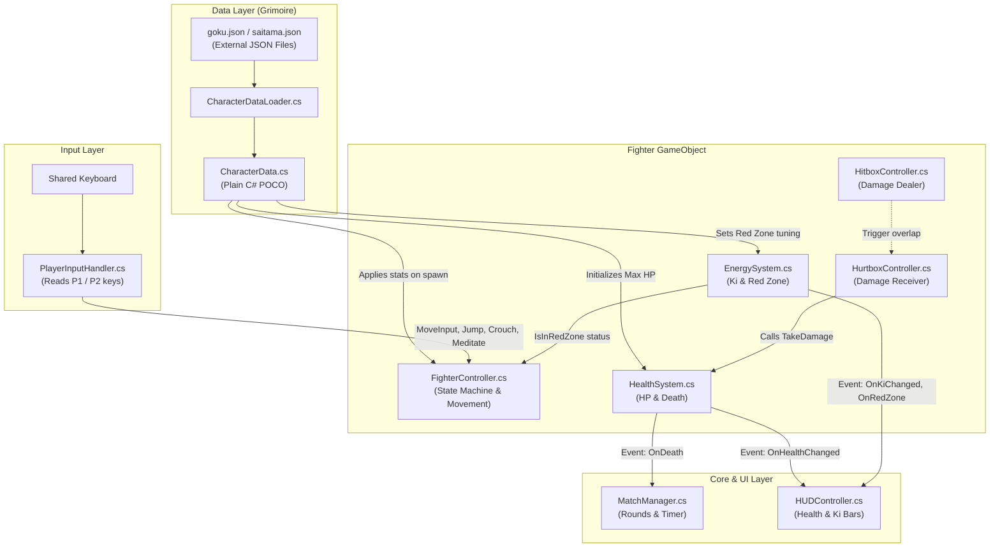
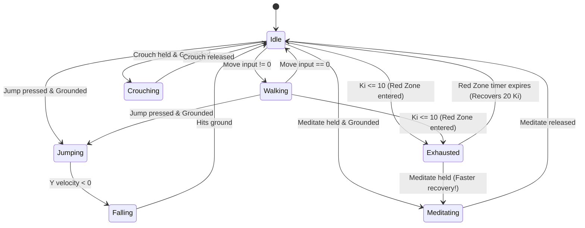

# 02. System Architecture & Design Patterns

> **Audience:** Core team developers, code reviewers, and viva / project defense evaluators.

---

## 1. High-Level Architectural Diagram

Mystic Combat is designed around **decoupled, modular components** communicating via **Data Contracts** and **C# Events**. No monolithic "Player" script exists.

---

## 2. Key Architecture Decisions

### Decision 1: The "Grimoire Architecture" (Data-Driven JSON)
**The Problem:** In traditional hackathon games, stats (HP, speed, damage, frame timings) are hardcoded directly into C# scripts or Inspector fields. Modifying balance requires editing code and waiting for Unity to recompile.
**Our Solution:** Character stats are stored in standalone external JSON files (`Assets/Data/Characters/*.json` and `StreamingAssets/Characters/*.json`).
- **Advantage 1:** Designers can rebalance characters (e.g. nerf Saitama's speed from `4.5` to `4.2`) without touching a single line of C#.
- **Advantage 2:** New characters can be added to the game simply by dropping a new `.json` file and a spritesheet into the project.
- **Advantage 3:** Explicit scoring bonus in the hackathon criteria for external data-driven architectures with runtime validation.

### Decision 2: Single Responsibility Principle (Separation of Concerns)
Instead of a giant 2,000-line `Player.cs`, responsibilities are strictly separated:

| Component | What it DOES | What it DOES NOT DO |
| :--- | :--- | :--- |
| **`PlayerInputHandler`** | Reads keyboard keys (`W/A/S/D` or `Arrows`). | Does not move the player or know what an attack is. |
| **`FighterController`** | Manages movement physics, states, jumping, and auto-facing. | Does not calculate damage or update UI. |
| **`HealthSystem`** | Stores HP, handles `TakeDamage()` and `Heal()`. | Does not know what attack hit the player. |
| **`EnergySystem`** | Stores Ki (0–100), handles meditation, manages 5-second Red Zone timer. | Does not draw UI or move the player. |
| **`HUDController`** | Updates UI bars and text. | Does not store or modify game variables. |

### Decision 3: Event-Driven Communication (Observer Pattern)
Components communicate through C# `event Action` rather than direct hard references.

**Example: When Goku takes damage:**
1. `HealthSystem.TakeDamage(15)` reduces HP from 100 to 85.
2. `HealthSystem` fires `OnHealthChanged?.Invoke(85, 100);`.
3. `HUDController` is listening to this event, so it slides the health bar down to 85%.
4. `HealthSystem` has **zero reference** to `HUDController`. If the HUD is disabled or deleted, the game will never crash!

---

## 3. Finite State Machine (FSM)

Fighting games are defined by strict state rules (e.g., *you cannot jump while being knocked back, and you cannot attack while exhausted*).

### State Transition Diagram:

### Why FSM is Critical for Fighting Games:
- Prevents invalid moves (e.g., cannot air-dash or jump when already in the air).
- Controls animation synchronization.
- Enforces the **Red Zone penalty**: when in `Exhausted` state, attack inputs are ignored, and horizontal velocity is clamped to $35\%$ of normal move speed.
