# 02. System Architecture & Design Patterns

> **Audience:** Core team developers, code reviewers, and viva / project defense evaluators.

---

## 1. High-Level Architectural Diagram

Mystic Combat is designed around **decoupled, modular components** communicating via **Data Contracts** and **C# Events**. No monolithic "Player" script exists.

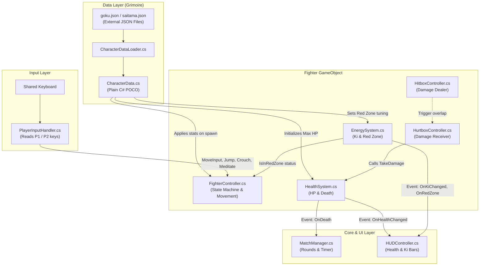

---

## 2. Key Architecture Decisions

### Decision 1: The "Grimoire Architecture" (Data-Driven JSON)
**The Problem:** In traditional hackathon games, stats (HP, speed, damage, frame timings) are hardcoded directly into C# scripts or Inspector fields. Modifying balance requires editing code and waiting for Unity to recompile.
**Our Solution:** Character stats are stored in standalone external JSON files (`Assets/Data/Characters/*.json` and `StreamingAssets/Characters/*.json`).
- **Advantage 1:** Designers can rebalance characters (e.g. nerf Saitama's speed from `4.5` to `4.2`) without touching a single line of C#.
- **Advantage 2:** New characters can be added to the game simply by dropping a new `.json` file and a spritesheet into the project.
- **Advantage 3:** Explicit scoring bonus in the hackathon criteria for external data-driven architectures with runtime validation.

### Decision 2: Single Responsibility Principle (Separation of Concerns)
Instead of a giant 2,000-line `Player.cs`, responsibilities are strictly separated:

| Component | What it DOES | What it DOES NOT DO |
| :--- | :--- | :--- |
| **`PlayerInputHandler`** | Reads keyboard keys (`W/A/S/D` or `Arrows`). | Does not move the player or know what an attack is. |
| **`FighterController`** | Manages movement physics, states, jumping, and auto-facing. | Does not calculate damage or update UI. |
| **`HealthSystem`** | Stores HP, handles `TakeDamage()` and `Heal()`. | Does not know what attack hit the player. |
| **`EnergySystem`** | Stores Ki (0–100), handles meditation, manages 5-second Red Zone timer. | Does not draw UI or move the player. |
| **`HUDController`** | Updates UI bars and text. | Does not store or modify game variables. |
| **`MainMenuController`** | Manages start screen navigation, mode selection, audio feedback, and options. | Does not execute in-match fight logic. |
| **`MatchAudioController`** | Manages in-match battle BGM escalation (Rounds 1/2 vs Match Point) and victory fanfare triggers via `MatchManager` events. | Does not handle damage calculation or character state transitions. |
| **`GameManager`** | Persists across scenes, stores chosen `GameMode` (Vs CPU / Local PvP) and selected character IDs. | Does not handle per-frame combat ticks. |

### Decision 3: Event-Driven Communication (Observer Pattern)
Components communicate through C# `event Action` rather than direct hard references.

**Example: When Goku takes damage:**
1. `HealthSystem.TakeDamage(15)` reduces HP from 100 to 85.
2. `HealthSystem` fires `OnHealthChanged?.Invoke(85, 100);`.
3. `HUDController` is listening to this event, so it slides the health bar down to 85%.
4. `HealthSystem` has **zero reference** to `HUDController`. If the HUD is disabled or deleted, the game will never crash!

---

## 3. Finite State Machine (FSM)

Fighting games are defined by strict state rules (e.g., *you cannot jump while being knocked back, and you cannot attack while exhausted*).

### State Transition Diagram:

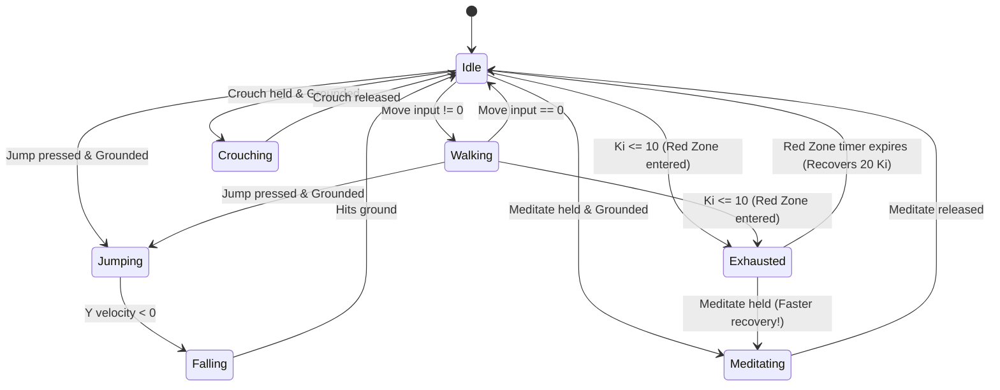

### Why FSM is Critical for Fighting Games:
- Prevents invalid moves (e.g., cannot air-dash or jump when already in the air).
- Controls animation synchronization.
- Enforces the **Red Zone penalty**: when in `Exhausted` state, attack inputs are ignored, and horizontal velocity is clamped to $35\%$ of normal move speed.

---

## 4. Combat Hitbox & Hurtbox Resolution Architecture

### Attack Phase Lifecycle
In competitive fighting games, attacks are divided into 3 distinct chronological phases:
1. **Startup (Windup):** The animation begins playing, but the hitbox is **inactive**. If hit during startup, the attack is counter-hit interrupted.
2. **Active (Strike Window):** The `HitboxController` activates its trigger `BoxCollider2D`. Overlaps with the opponent's `HurtboxController` resolve damage, apply physics knockback, and award Ki.
3. **Recovery (Cooldown):** The hitbox deactivates. The fighter finishes the follow-through animation before returning to `Idle`.

```
[ Attack Started ]
       │
       â–¼
[ 1. Startup Phase ]    (Hitbox OFF, player committed)
       │
       â–¼
[ 2. Active Window ]    (Hitbox ON, damage + knockback + Ki resolved)
       │
       â–¼
[ 3. Recovery Phase ]   (Hitbox OFF, cooldown before returning to Idle)
```

### Multi-Hit Prevention
To avoid a single attack dealing multiple hits over consecutive physics frames, `HitboxController` maintains a `HashSet<Transform> hitTargetsThisSwing`. Once a target is hit during an attack swing, subsequent overlap events for that same target are suppressed until the next attack begins.

---

## 5. Tournament Arcade HUD & Event-Driven UI Architecture

### Loose Coupling via Observer Pattern
The user interface in Mystic Combat is strictly decoupled from the gameplay simulation:
- **`HealthSystem` & `EnergySystem`** have **zero** awareness of the UI Canvas. They broadcast pure C# events (`OnHealthChanged`, `OnKiChanged`, `OnRedZoneEnter`, `OnRedZoneExit`).
- **`MatchManager`** coordinates round state, round timers, and win counts without referencing UI elements. It broadcasts `OnTimerUpdate`, `OnRoundStart`, and `OnRoundEnd`.
- **[`HUDController.cs`](file:///B:/Unity/Projects/Mystic_Combat_Animeverse_Incursion/Assets/Scripts/UI/HUDController.cs)** acts as the **Observer (View)**: it subscribes to these events and animates the health bars, damage ghost bars, Ki gauges, and the central Time Stone.

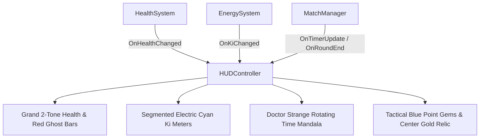

### Self-Healing Auto-Discovery Pattern (Prefab Decoupling)
In Unity, saving a Canvas as a reusable Prefab (`Assets/Prefabs/UI/HUD_Canvas.prefab`) causes the engine to strip scene object references (such as `Fighter_P1_Goku`).
To eliminate fragile inspector wiring and ensure the HUD never goes inactive:
- [`HUDController.cs`](file:///B:/Unity/Projects/Mystic_Combat_Animeverse_Incursion/Assets/Scripts/UI/HUDController.cs) implements **Self-Healing Reference Resolution** (`ResolveReferences()`) across `Awake()`, `Start()`, and `OnEnable()`.
- If fighter references are null, it queries the scene for `Fighter_P1_Goku` and `Fighter_P2_Saitama` and binds to their events dynamically.
- This mirrors Godot's safe `_ready()` signal discovery (`get_node_or_null()`), allowing the HUD prefab to be dropped into any test scene with zero manual setup.

### Screen Space Canvas & Reference Resolution
- **Canvas Scaler:** Configured to `Scale With Screen Size` with a reference resolution of `1920 × 1080` and `Match Width Or Height = 0.5`.
- **Anchor Normalization:**
  - Player 1 Combat Card (Goku) is anchored to `Top-Left (0, 1)`.
  - Player 2 Combat Card (Saitama) is anchored to `Top-Right (1, 1)`.
  - Mystic Time Stone & Match Point Relic are anchored to `Top-Center (0.5, 1)`.
- **Result:** The HUD scales seamlessly from 1080p to 4K displays and ultrawide monitors without distortion or element clipping.

### Layered HUD Hierarchy & Visual Composition (v11)
To combine high-impact anime presentation with seamless 2D performance, the HUD uses a clean, non-clipping multi-layer hierarchy:
1. **Background Layer:** `Mystic_Runic_Banner` (900×48) anchored behind the top center cluster, displaying green Tao runic circles and eldritch spell glyphs.
2. **Container Layer:** `P1_HealthBar_Container` & `P2_HealthBar_Container` (650×52) featuring 8px beveled gold rims.
3. **Fill Layer:** `GhostFill` (red trailing damage) and `HealthFill` (2-tone lime/gold health) offset inwards by `(8px, 6px)` so the fills never spill past the frame.
4. **Header Frieze Layer:** `Mystic_Runic_Banner` (960×36) repositioned along the top border (`y = -18`) with glowing jade Taoist eldritch mandalas and runic bridges framing the entire combat cluster.
5. **Foreground Typography:** TextMeshProUGUI with `enableVertexGradient = true`, delivering GPU-accelerated 3D multi-color gradients (Goku solar flame gold, Saitama crimson maroon, Timer emerald glow).
6. **Dynamic Match Point Championship Relic & Dual Round Gem Trackers:**
   - **Dual Round Gems per Fighter:** Each player has two 56×56px point gem sockets near their avatar card (`P1_PointGem_1`, `P1_PointGem_2`, `P2_PointGem_1`, `P2_PointGem_2`). When a fighter wins Round 1, Gem 1 ignites to `gem_shiny_blue.png`. When they win Round 2, Gem 2 ignites and the tournament victory sequence triggers.
   - **Center Championship Relic:** Enlarged to 68×68px, initialized with a round hollow golden socket (`gem_big_gold_hollow.png`). Dynamically evaluates `(p1Wins >= 1 || p2Wins >= 1)`. When either fighter reaches match point, `HUDController` ignites the socket into the radiant golden gem ([`gem_big_gold.png`](file:///B:/Unity/Projects/Mystic_Combat_Animeverse_Incursion/Assets/Sprites/UI/gem_big_gold.png), extracted from the user's multi-gem screenshot `Screenshot 2026-10-25 112541.png`) with an active breathing pulse animation ($1.0\times \rightarrow 1.15\times$).
   - **Enlarged Emerald Time Stone:** Scaled up to 56×56px atop the rotating Tao mandala, creating a bold, crystalline focal point.

---

## 13. Round Lifecycle State Machine & Autonomous Respawn Protocol

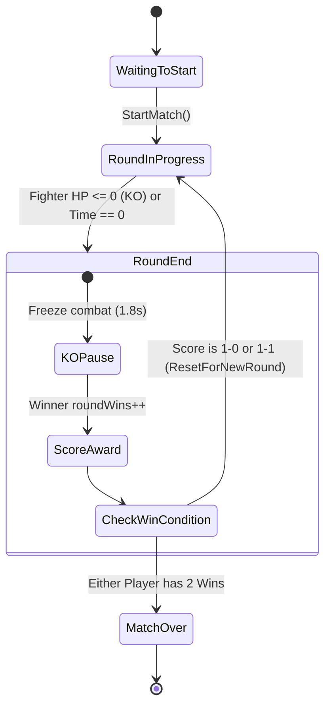

### Complete Round Reset Architecture (`ResetForNewRound`):
To prevent state bleed-through between rounds, each round starts completely fresh:
1. **Positional Snap:** Goku resets to `Vector3(-2.2f, -3.0f, 0f)` (facing Right); Saitama resets to `Vector3(2.2f, -3.0f, 0f)` (facing Left).
2. **Physics Zeroing:** Rigidbody2D `linearVelocity` is clamped to `Vector2.zero` to eliminate lingering knockback momentum.
3. **State Machine Reset:** Current fighter state transitions to `FighterState.Idle`, attack cooldown timers reset to $0$, and active hitboxes are deactivated with cleared target lists.
4. **Vitals & UI Synchronization:** Health resets to $100$ and Ki resets; `HUDController.ResetHealthBarsInstantly()` clears trailing damage ghost bars immediately.
5. **Round 3 Decider:** If the score reaches 1–1, Round 3 automatically initiates as the Final Round Match Point.

---

## 14. Audio Architecture & Combat SFX Pipeline

Mystic Combat implements a decoupled, state-driven audio pipeline separating tournament match music from per-character combat audio profiles:

```mermaid
graph TD
    subgraph Match Flow ["Match Flow Audio (MatchAudioController)"]
        MatchManager["MatchManager.cs"]
        RoundStart["OnRoundStart"]
        RoundEnd["OnRoundEnd"]
        MatchOver["OnMatchOver"]
        
        StartBell["1. Loud Round Bell (Vol=1.0)"]
        Delay["2. 0.85s Dramatic Pause"]
        BGM["3. Battle BGM (from 0:00)"]
        KOBell["1. KO Bell + Stop BGM"]
        Fanfare["Victory Fanfare (Double Dragon 3)"]
        
        MatchManager --> RoundStart --> StartBell --> Delay --> BGM
        MatchManager --> RoundEnd --> KOBell
        MatchManager --> MatchOver --> Fanfare
    end

    subgraph Fighter Combat Audio ["Fighter Audio Pipeline (FighterAudio.cs)"]
        FC["FighterController.cs<br/>(Fighter State Machine)"]
        Hitbox["HitboxController.cs<br/>(Damage Connection)"]
        
        FA["FighterAudio.cs<br/>(OneShot + Looping Aura Sources)"]
        
        FC -->|TransitionTo(Jumping)| FA
        FC -->|TransitionTo(LightAttack/HeavyAttack)| FA
        FC -->|TransitionTo(Skill/Ultimate)| FA
        FC -->|TransitionTo(Meditating)| FA
        FC -->|Transition (Falling -> Grounded)| FA
        Hitbox -->|ResolveHit (Light/Heavy/Skill/Ult Damage)| FA
    end
```

### Key Architectural Pillars:
1. **State-Driven Audio (Input-Decoupled):**
   - Audio is NEVER triggered from raw button presses (`Input.GetKeyDown`).
   - Sounds execute exclusively on state entry in `FighterController.TransitionTo(newState)`.
   - Landing sounds execute when ground check confirms transition from airborne to grounded.
   - This ensures full compatibility across **P1, P2, CPU AI, Network Netcode, and Replay systems** without code duplication.
2. **Fighter-General Audio Profiles (Multi-Character Extensibility):**
   - [`FighterAudio.cs`](file:///b:/Unity/Projects/Mystic_Combat_Animeverse_Incursion/Assets/Scripts/Combat/FighterAudio.cs) is a modular, character-agnostic component attached to any fighter entity.
   - Every character prefab (`Goku.prefab`, `Saitama.prefab`, or future fighters like `Naruto` or `Vegeta`) exposes individual serialized `AudioClip` slots in the Inspector:
     - Common agility: `jumpClip`, `landClip`, `dashClip`
     - Attack whiffs: `lightWhiffClip`, `heavyWhiffClip`
     - Special skills: `skillAttackClip`, `ultimateAttackClip`
     - Hit reactions: `lightHitClip`, `heavyHitClip`, `skillHitClip`, `ultimateHitClip`
     - Aura & exhaustion: `kiChargeLoopClip`, `redZoneWarningClip`
     - Character voiceovers: `voiceSkillClip`, `voiceUltimateClip`
3. **Decoupled Sound Channels:**
   - **One-Shot Polyphonic Channel (`AudioSource.PlayOneShot`):** Plays whiffs, crunchy hit impacts, jumps, and signature dialogue lines with zero latency and zero cutoff during rapid combos.
   - **Looping Channel (`AudioSource.Play` with `loop = true`):** A dedicated child `AudioSource` playing `kiChargeLoopClip` continuously during meditation, tuned to 60% volume (`0.45f`) to prevent acoustic fatigue, automatically halted on state exit.
4. **Dialogue Synchronization for Fast-Paced Combat:**
   - Voice lines are trimmed to remove dead-air reverb tails and accelerated ($1.20\times - 1.25\times$) so that verbal calls (e.g., Goku's *"Kamehameha"* at $3.36\text{s}$, Saitama's *"Consecutive Normal Punches"* at $2.20\text{s}$ and *"Serious Punch"* at $3.17\text{s}$) match the rapid execution speeds of modern fighting game specials without desyncing from gameplay.
5. **Curated SFX Library (`Assets/Audio/SFX_Library/`):**
   - Over 50 studio foley hits, anime power blasts, swishes, and tournament gongs organized in four categories (`Anime_Powers`, `Arcade_Bells`, `Hits_Punches`, `Swishes_Whiffs`), ready for one-click auditioning and drag-and-drop assignment in the Unity Inspector.


---

## 7. Character Select Menu & Match Handoff Architecture

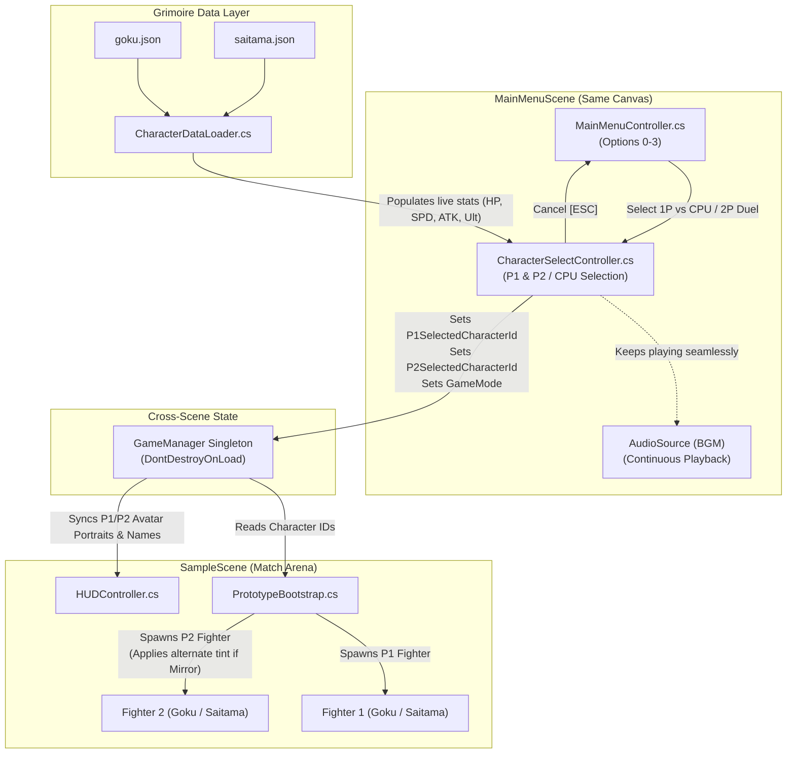

### Key Architectural Highlights:
1. **Zero-Hitch In-Canvas Screen Transition:**
   - Switching between Title Marquee and Character Selection occurs via GameObject activation (`menuRoot.SetActive(false)` / `characterSelectRoot.SetActive(true)`) within the same Canvas hierarchy.
   - The cosmic background image, vignette overlay, and background music stream continuously without stopping, restarting, or popping.
2. **Dynamic Grimoire Binding:**
   - Rather than baking hardcoded stat values into TextMeshPro labels, `CharacterSelectController` calls `CharacterDataLoader.Load(id)` on open.
   - Any rebalancing made to `moveSpeed`, `health`, `lightAttack.damage`, `skill.name`, or `ultimate.name` in `goku.json` or `saitama.json` immediately reflects on the selection cards.
3. **Mirror Match Resolution Pipeline:**
   - If both players pick the same fighter (e.g. Goku vs Goku), the system automatically detects the collision (`p1Char == p2Char`).
   - `CharacterSelectController` surfaces a `[ MIRROR MATCH: P2 ALTERNATE PALETTE ]` badge.
   - `PrototypeBootstrap` injects an alternate color tint into Player 2's `SpriteRenderer` (e.g., Ice/Cyan Gi for Goku or Amber/Orange for Saitama), guaranteeing immediate visual clarity in 2D combat.
4. **Hybrid CPU Mode (Manual + Instant Random):**
   - Supports both deliberate player selection (P1 picks opponent) and instant randomized single-button match launching (`[R]` key or `[ RANDOM CPU ]` button).

---

## 6.3 Fighter Sprite Rendering Pipeline & High-Contrast Cel-Inking Architecture

```
┌────────────────────────────────────────────────────────────────────────┐
│               Fighter Sprite Visual Processing Pipeline                │
└────────────────────────────────────────────────────────────────────────┘
  Disk Image Files (skill_0.png .. skill_11.png)
       │
       ▼
  FighterAnimator.LoadFrame()
       │
       ├─► File.ReadAllBytes(path)
       ├─► Texture2D (FilterMode.Point, TextureFormat.RGBA32)
       ├─► Calculate Standardized Baseline Pivot (160x160 -> Y: 0.15625)
       └─► Sprite.Create(tex, rect, pivot, pixelsPerUnit: 28f)
       │
       ▼
  SpriteRenderer (Universal 2D Pipeline)
       │
       ├─► Outer Perimeter: Solid 1px Deep Inking (#080404) -> Zero Background Bleed
       ├─► Strike Leading Edge: Kinetic Shockwave Flash (#FFFFFF / #FFD76E)
       └─► High-Contrast Silhouette: >8:1 Contrast Ratio on Dark Arena Tiles
```

### Architectural Principles:
1. **Zero-Shader Overhead:** Rather than binding costly 2D outline shaders (which require multiple texture samples per fragment in a Custom Post-Processing / Sprite Unlit pass), silhouettes are baked into pixel-perfect assets rendered via Unity's default `SpriteRenderer`.
2. **Reversion Safety Architecture:** Original assets are preserved bit-for-bit in `Assets/Sprites/Fighters/Saitama/Original_Skill_Backup/`, allowing instant rollback via `revert_skill_frames.py` with zero risk of asset loss.
3. **Point Filtering Fidelity:** Textures are instantiated with `FilterMode.Point`, preserving razor-sharp pixel grids without bilinear blurring or anti-aliasing artifacts.

---

## 6.4 Combat Loop & Menu State Transitions (Pause & Rematch Architecture)

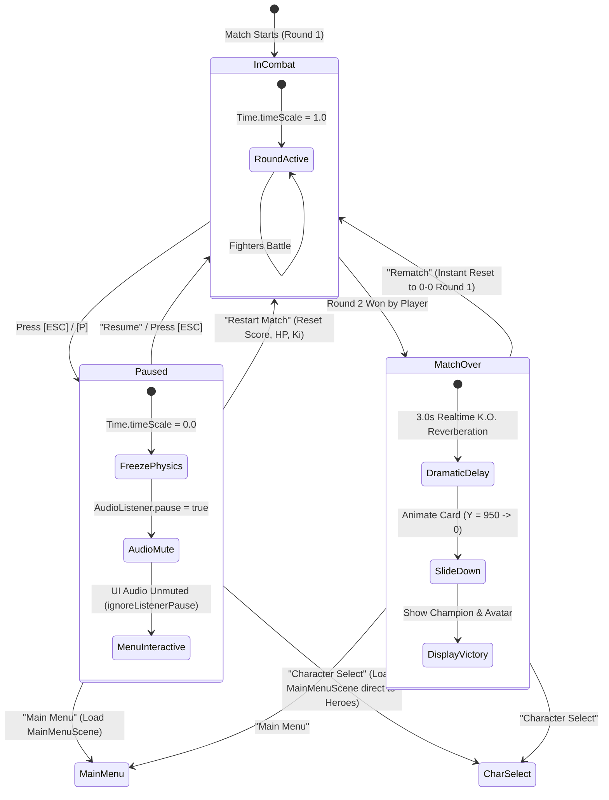

### Architectural Principles:
1. **Unscaled Time Processing:** UI animations, button interactions, and navigation audio continue executing while physics is frozen because UI reads unscaled time and `ignoreListenerPause = true`.
2. **Direct Cross-Scene Route Acceleration:** Selecting "Character Select" sets `GameManager.Instance.CurrentState = GameState.CharacterSelect`, which tells `MainMenuController` to immediately bypass the title marquee and open directly into Hero Selection.
3. **In-Memory Instant Rematch:** Selecting "Rematch" avoids reloading the entire Unity scene, resetting round variables, positions, and health in-memory for instant $< 0.1\text{s}$ responsiveness.
4. **Match-Lifecycle Input Gating:** `PlayerInputHandler` gates input by `MatchManager.CurrentMatchState == RoundInProgress`, ensuring fighters only accept inputs during active rounds and remain freeze-framed after K.O. and before the opening bell.
5. **Zero-Dimming Arena Transparency:** Results modal uses a transparent backdrop (`Color.clear`) so the arena environment and fighters remain fully visible and illuminated behind the championship card.

---

## 11. CPU Artificial Intelligence: Hierarchical State Machine (HFSM) & Input Abstraction

### Architectural Overview
Rather than hardcoding AI logic directly into fighter movement scripts, Mystic Combat implements a **Virtual Controller Architecture** driven by a **Hierarchical Finite State Machine (HFSM)**.

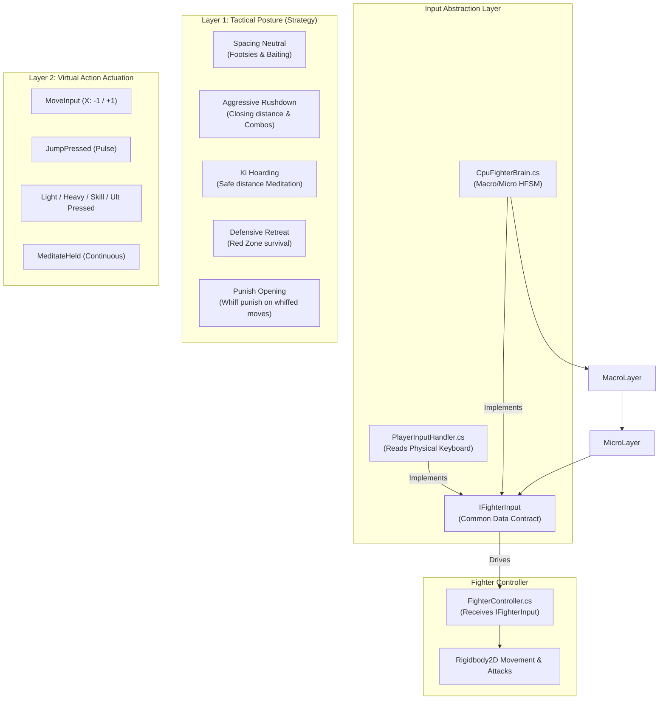

### Key Architectural Pillars:
1. **Zero-Cheating Guarantee (Pure Fair Play):**
   - The CPU AI cannot bypass startup frames, cancel un-cancelable recovery windows, or teleport.
   - It emits standard virtual inputs (`IFighterInput`) into `FighterController`, executing through the exact same physics and combat rules as human players.
2. **Layer 1: Macro Tactical HFSM:**
   - Evaluated periodically via a humanized **Reaction Tick** ($\Delta t \approx 0.14\text{s} - 0.40\text{s}$).
   - Decisions are made by inspecting:
     - $X$-distance to opponent.
     - Bot's own HP and Ki resources.
     - Opponent's HP, Ki, and state (`IsOpponentInRedZone`, `IsOpponentMeditating`, `IsOpponentInRecovery`).
3. **Layer 2: Micro Virtual Actuation:**
   - Single-frame trigger buttons (`JumpPressed`, `LightAttackPressed`, `HeavyAttackPressed`, `SkillPressed`, `UltimatePressed`) are pulsed for 1 frame and automatically cleared in `LateUpdate()`.
   - Continuous inputs (`MoveInput`, `MeditateHeld`, `CrouchHeld`) are maintained across frames until macro re-evaluation.
4. **Character-Specific Combat Personalities:**
   - **Goku (`GokuBrain.cs`):** Disciplined martial artist. Spacing preferred at $\approx 2.1\text{m}$. Charges Ki proactively at distance. Fires *Kamehameha* from mid-range when $\text{Ki} \ge 20$. Hoards $80\text{ Ki}$ for his Ultimate blast.
   - **Saitama (`SaitamaBrain.cs`):** Overwhelming in-your-face brawler. Preferred distance $< 1.0\text{m}$. Refuses to back down in neutral. Drops *Consecutive Normal Punches* point-blank. Hoards $100\text{ Ki}$ and relentlessly hunts down the player for the game-ending *Serious Punch*.
5. **Configurable Difficulty Profiles (`CpuBrainProfile.cs`):**
   - `Easy`: Longer reaction delay ($0.40\text{s}$), $35\%$ mistake/hesitation rate, low combo confirmation ($30\%$).
   - `Hard`: Arcade reflex delay ($0.14\text{s}$), $8\%$ mistake rate, high combo confirmation ($85\%$).
   - `Extreme`: Tournament boss reaction ($0.08\text{s}$), stat-scaled $1.4\times\text{ HP}$ and $1.25\times\text{ Damage}$.

---

## 12. Dynamic Prefab Deployment & Scene Independence Architecture

### Architectural Overview
Rather than baking static character instances into the combat arena (`SampleScene.unity`), Mystic Combat utilizes a **Deployer Pattern** that instantiates character prefabs dynamically on scene load based on `GameManager` session state.

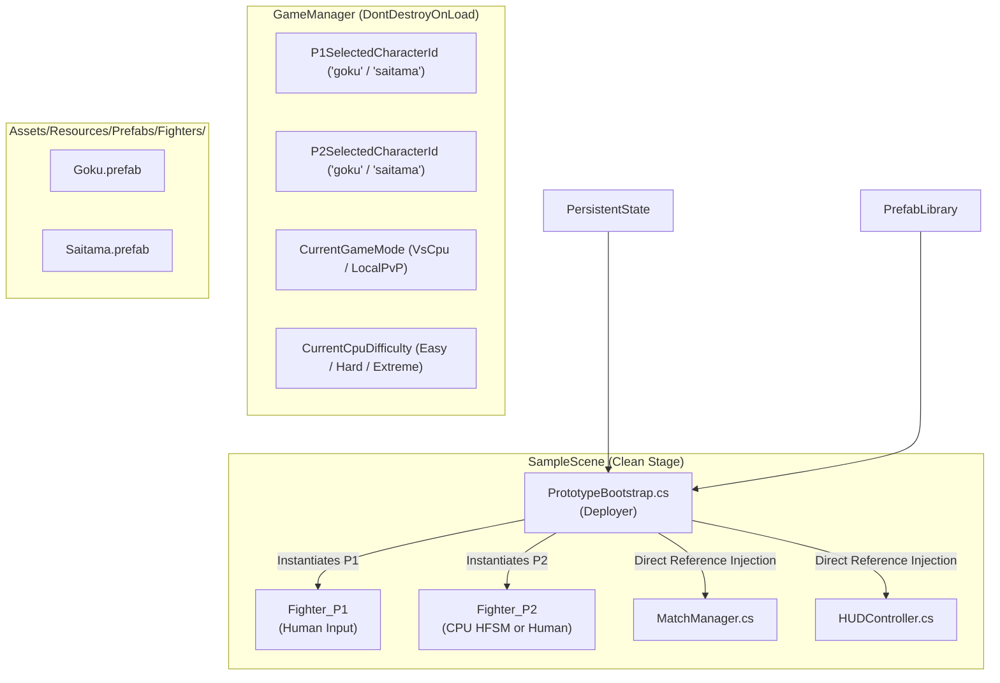

### Architectural Principles:
1. **Stage Reusability & Zero Entity Hardcoding:** The arena scene contains only the environment geometry, camera, boundary walls, lights, HUD, and referee (`MatchManager`). Any character combination (Goku vs. Saitama, Saitama vs. Goku, Goku vs. Goku mirror, Saitama vs. Saitama mirror) runs on the exact same arena scene.
2. **Elimination of `GameObject.Find()` Name Brittle Dependencies:** `MatchManager` and `HUDController` no longer rely on finding hardcoded string names like `"Fighter_P1_Goku"`. They either receive references directly from `Deployer.SetFighterReferences()` or auto-discover generic `"Fighter_P1"` / `"Fighter_P2"` entities.
3. **Dynamic Resource Loading:** Prefabs reside in `Assets/Resources/Prefabs/Fighters/`, allowing runtime loading via `Resources.Load<GameObject>()` in standalone standalone player builds without requiring editor-only `AssetDatabase` APIs.
4. **Mirror Match Resolution:** When `p1Char == p2Char`, Player 2 receives an alternate palette tint at runtime ($0.70\text{R}, 0.85\text{G}, 1.25\text{B}$ for Goku's Ice Gi; $1.15\text{R}, 0.85\text{G}, 0.70\text{B}$ for Saitama's Solar Suit), ensuring visual clarity without creating separate duplicate prefab files.

---

## 13. Dynamic Controls & Options Architecture: Audio Mixing & Game-Mode Input Profiles

### System Overview
The options subsystem enables players to customize audio levels and remap controls for two distinct gaming contexts:
1. **Single Player Mode (Vs CPU & Future LAN):** Player 1 possesses the entire keyboard (9 actions mapped without restriction).
2. **1v1 Local Duel Mode (Shared Keyboard):** Two players share a single keyboard (18 distinct, non-overlapping keys) presented in a unified 3-column table.

```mermaid
graph TD
    subgraph UI Layer ["Main Menu: Options & Controls Modal"]
        Sliders["Top Audio Sliders<br/>(Music BGM & SFX Sound)"]
        Tabs["Profile Switcher Tabs<br/>(Single Player vs. Local Duel)"]
        TableSP["Single Player Table<br/>(9 Action Rows x 1 Key)"]
        TableLD["Combined Local Duel Table<br/>(9 Action Rows x 2 Players)"]
        OptCtrl["OptionsMenuController.cs<br/>(Rebind Listener & Event Hooks)"]
    end

    subgraph Data & Persistence Layer ["Systems Layer"]
        ISM["InputSettingsManager.cs<br/>(In-Memory Key Maps & Volume State)"]
        Prefs["Unity PlayerPrefs<br/>(Persistent Registry / Plist / File)"]
    end

    subgraph Runtime Combat Layer ["In-Game Execution"]
        PIH_P1["PlayerInputHandler (P1)"]
        PIH_P2["PlayerInputHandler (P2)"]
        GM["GameManager.Instance.CurrentGameMode"]
    end

    Sliders -->|Live Volume Updates| ISM
    OptCtrl -->|Key Rebind Events| ISM
    ISM -->|Save / Load| Prefs

    GM -.->|Query Mode| PIH_P1
    ISM -->|GetRuntimeKey(action, isP2, isLocalDuel)| PIH_P1
    ISM -->|GetRuntimeKey(action, isP2=true, isLocalDuel=true)| PIH_P2
```

### Architectural Principles:
1. **Unified Runtime Key Resolution:**
   Instead of checking game modes repeatedly inside input poll loops, `PlayerInputHandler` queries `InputSettingsManager.GetRuntimeKey(action, isPlayer2, isLocalDuel)`:
   - For Player 1 in `VsCpu` (or LAN): pulls from the Single Player profile.
   - For Player 1 in `LocalPvP`: pulls from Local Duel P1 profile.
   - For Player 2 in `LocalPvP`: pulls from Local Duel P2 profile.
2. **Interactive Event-Driven Rebinding:**
   Clicking any key button puts `OptionsMenuController` into an interception state. In `Update()`, it checks `Keyboard.current.allKeys` for `wasPressedThisFrame`, commits the key, and invokes `InputSettingsManager.SaveAllSettings()`. Pressing `[Escape]` cancels cleanly.
3. **Combined Table UI Pattern:**
   In local shared keyboard fighting games, viewing both players' key configurations side-by-side in a 3-column table (`[ Action ] | [ P1 Key ] | [ P2 Key ]`) prevents key overlap bugs and speeds up tournament setup.

---

## 14. Hierarchical UI Screen State Machine & Obvious Focus Routing

### Overview
To accommodate high-visibility typography ($80\%$ scale increase) without visual compression, `OptionsMenuController` employs an explicit **Hierarchical Screen State Machine**:

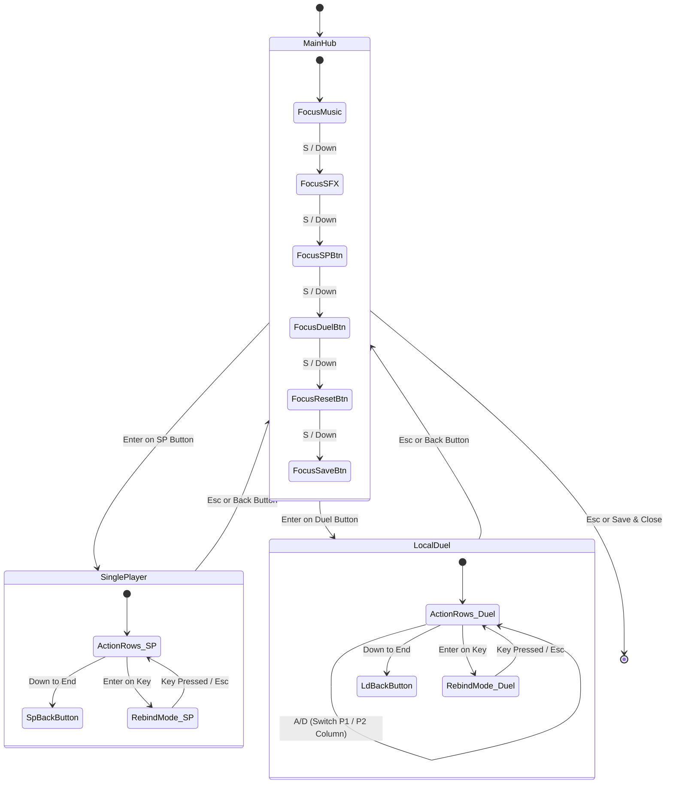

### Architectural Principles:
1. **Zero Overlap via View Decoupling:** Only one view panel is active at any time (`mainHubPanel`, `singlePlayerPanel`, or `localDuelPanel`). The $1440 \times 880\text{px}$ canvas provides dedicated space for each screen.
2. **Obvious Focus Indirection:** The player never reads navigation instructions. The active item dynamically renders a leading `►` symbol and its `Outline` component executes a real-time sine-wave color blend between Solar Gold (`#FFD54F`) and Pure White (`#FFFFFF`).
3. **Directional Multiplexing:**
   - In `MainHub`, $A/D$ and Left/Right nudge sliders ($5\%$ steps).
   - In `LocalDuel`, $A/D$ shifts horizontal focus between Player 1's column and Player 2's column.
   - $W/S$ and Up/Down navigate vertical rows with a repeat delay gate ($0.20\text{s}$).

---

## 11. Dynamic Character Deployment & Scene Transition Lifecycle Architecture

Mystic Combat separates **character selection metadata** from **scene visual rendering**. The combat arena scene (`SampleScene.unity`) contains zero hardcoded fighter instances.

### Scene Transition & Deployment Sequence

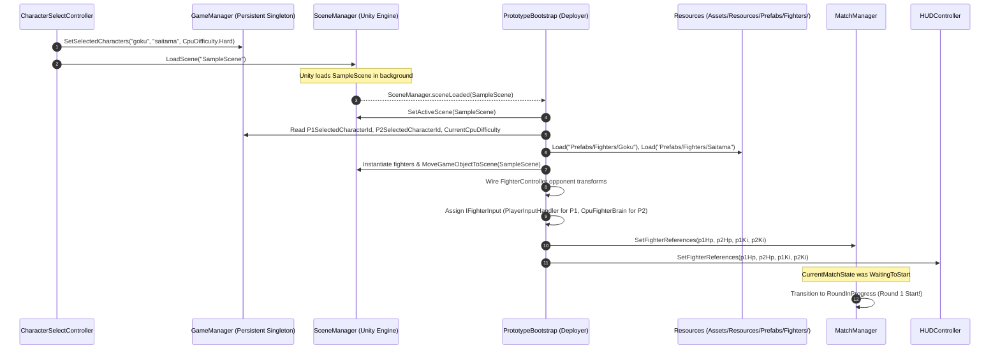

### Key Architectural Safeguards:
1. **Explicit Scene Migration (`MoveGameObjectToScene`):**
   - Unity's `SceneManager.GetActiveScene()` does not immediately update to the new scene until all `sceneLoaded` handlers complete.
   - To guarantee GameObjects are never abandoned in the outgoing scene or unloaded prematurely, `PrototypeBootstrap` explicitly shifts newly instantiated GameObjects into the loaded scene via `SceneManager.MoveGameObjectToScene()`.
2. **`MatchState.WaitingToStart` Synchronization Guard:**
   - `MatchManager` initializes its state to `MatchState.WaitingToStart`.
   - If `MatchManager.Start()` runs before `PrototypeBootstrap` finishes instantiating prefabs, it logs a waiting notice and does not begin the round timer.
   - When `SetFighterReferences()` is called by the deployer, it detects `WaitingToStart` and immediately triggers `StartMatch()`.
3. **Editor Direct-Play Resilience (`[RuntimeInitializeOnLoadMethod(AfterSceneLoad)]`):**
   - For developer velocity, developers can open `SampleScene.unity` directly in the Unity Editor and press Play without running through `MainMenuScene`.
   - `[RuntimeInitializeOnLoadMethod(AfterSceneLoad)]` intercepts this and deploys default fighters (Goku vs. Saitama) automatically if no Character Select data exists.

---

## 17. Centralized Audio Routing & Master Balancing Architecture

To achieve arcade audio punch without clipping or loudness fatigue, Mystic Combat routes all audio through persistent master multipliers managed by [`InputSettingsManager.cs`](file:///b:/Unity/Projects/Mystic_Combat_Animeverse_Incursion/Assets/Scripts/Systems/InputSettingsManager.cs).

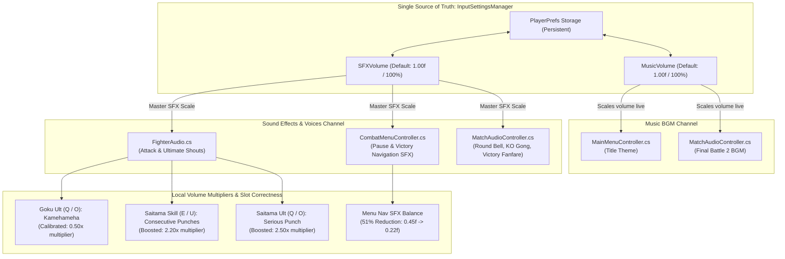

### Architectural Principles:
1. **Normalized Master Multipliers:**
   - Background music sources (`musicSource.volume = battleMusicVolume * InputSettingsManager.MusicVolume`) and one-shot sound effects (`sfxSource.PlayOneShot(clip, clipVolume * InputSettingsManager.SFXVolume)`) multiply their baseline design volume by the master setting.
2. **Move-Slot Semantic Integrity:**
   - Moves in the fighting system map strictly to their design contracts: Goku has no special skill; his signature Ultimate is **Kamehameha** (Ki: 80, `Q`/`O`), bound to `voiceUltimateClip` and animated across `ultimate_0..9`. Saitama features Consecutive Normal Punches on Skill (`E`/`U`) and Serious Punch on Ultimate (`Q`/`O`).
3. **Perceptual Loudness Equalization (LUFS Balancing):**
   - High-gain recordings (`goku_voice_kamehameha.wav`, peak `0.906`) are attenuated to `0.50f` on his Ultimate, while soft vocal clips (`consecutive_normal_punches.mp3`, `serious_punch.mp3`) are amplified to `2.20f` and `2.50f`, ensuring all special moves share balanced perceived loudness during combat.
4. **Single-Pass Amplitude Scaling:**
   - Audio sources remain unattenuated (`volume = 1.0f`), and `InputSettingsManager.SFXVolume` is applied as the final scalar in `PlayOneShot()`, eliminating the double-multiplication bugs that occur when both source and clip are scaled.

---

## 18. Tactical AI Architecture & Dynamic Hitbox/Hurtbox Synchronization

Mystic Combat's CPU Bot architecture decouples strategic decision-making from physical actuation via an input abstraction contract (`IFighterInput`), regulated by humanized action cadence timers.

```mermaid
graph TD
    subgraph Macro Layer ["Layer 1: Tactical HFSM (CpuFighterBrain.cs)"]
        Evaluate["EvaluateTacticalState()<br/>(Throttled Reaction Tick: 0.04s - 0.25s)"]
        Rush["RushdownPressure<br/>(Aggressive Gap Close & Strike)"]
        Punish["PunishOpening<br/>(Ultimate / Skill Whiff Punish)"]
        Neutral["SpacingNeutral<br/>(Dynamic Footsies & Counter-Poke)"]
        Charge["KiCharge<br/>(Meditate at Range >= 3.2m)"]
        Recovery["ExhaustionRecovery<br/>(Red Zone 1.5x Accelerated Meditation)"]
        Evaluate --> Rush & Punish & Neutral & Charge & Recovery
    end

    subgraph Combat Intelligence ["Layer 2: Combat Engine & Chain-Canceling"]
        SSJCheck["Goku SSJ Ascension<br/>(Ki >= 35 -> Trigger Skill immediately)"]
        HitConfirm["Hit-Confirm Combo Engine<br/>(Light lands -> Chain-cancel into Heavy or Skill)"]
        CrouchDuck["Defensive Crouch Duck<br/>(Ducks under high strikes)"]
        CornerAware["Corner Boundary Awareness<br/>(|x| > 7.0m: escape jump or fight out)"]
    end

    subgraph Actuation Layer ["Layer 3: 2-Frame Latched Virtual Actuation (IFighterInput)"]
        Latch["2-Frame Latch Counters<br/>(Zero dropped inputs regardless of execution order)"]
        FC["FighterController.cs<br/>(Obeys Exact Same Frame Data as Human)"]
        Hitbox["HitboxController.cs<br/>(Melee reach 1.55m, Kamehameha 6.5m)"]
        Hurtbox["HurtboxController.cs<br/>(Dynamic BoxCollider2D height on duck)"]
    end

    Macro Layer --> Combat Intelligence
    Combat Intelligence --> Actuation Layer
    Actuation Layer --> Hitbox & Hurtbox
```

### Architectural Principles:
1. **Frame-Reliable 2-Frame Input Latching:**
   - Fragile `LateUpdate()` clearing has been eliminated. Single-frame button events are managed via 2-frame latch counters (`lightLatch`, `heavyLatch`, `skillLatch`, `ultimateLatch`, `jumpLatch`).
   - Whether `FighterController.Update()` executes before or after `CpuFighterBrain.Update()`, the virtual key is guaranteed to be held high across the frame evaluation boundary.
2. **Every-Frame Hit-Confirm Chain-Canceling:**
   - The bot monitors `myController.HasHitTargetThisSwing` every frame. On hit confirmation during a Light Attack, it immediately cancels recovery into a Heavy Haymaker or special Skill.
3. **Character Asymmetry & Form Ascension:**
   - **Goku:** Continuously monitors Ki. At $35\text{ Ki}$, immediately triggers `Skill` to activate Super Saiyan form ($+25\%$ speed, $+66\%$ light damage, $+43\%$ heavy damage). Fires $6.5\text{m}$ Kamehameha blasts on openings.
   - **Saitama:** Pure in-your-face rushdown brawler. Chains into Consecutive Normal Punches ($15\text{ hits} / 30\text{ dmg}$) and fires the $90\text{-damage}$ Serious Punch upon reaching $80\text{ Ki}$.
4. **Dynamic Physics Collider Resizing:**
   - In `FighterController.TransitionTo()`, entering `FighterState.Crouching` dynamically halves the `Hurtbox` `BoxCollider2D` height ($1.8\text{m} \to 0.55\text{m}$), allowing fighters to duck cleanly under high punches.
3. **Attack Reach Geometry Synchronization:**
   - `HitboxController.ConfigureAttack()` synchronizes both internal calculation vectors and the physical `BoxCollider2D.size` and `offset`. Goku's Kamehameha expands the trigger zone to $3.6\text{m}$, accurately reflecting the full-screen visual energy blast.

---

## 19. Audio State Synchronization & Self-Healing Lifecycle Architecture

Mystic Combat decouples combat music playback from fragile scene transition timing gaps by employing a **self-healing state verification handshake**.

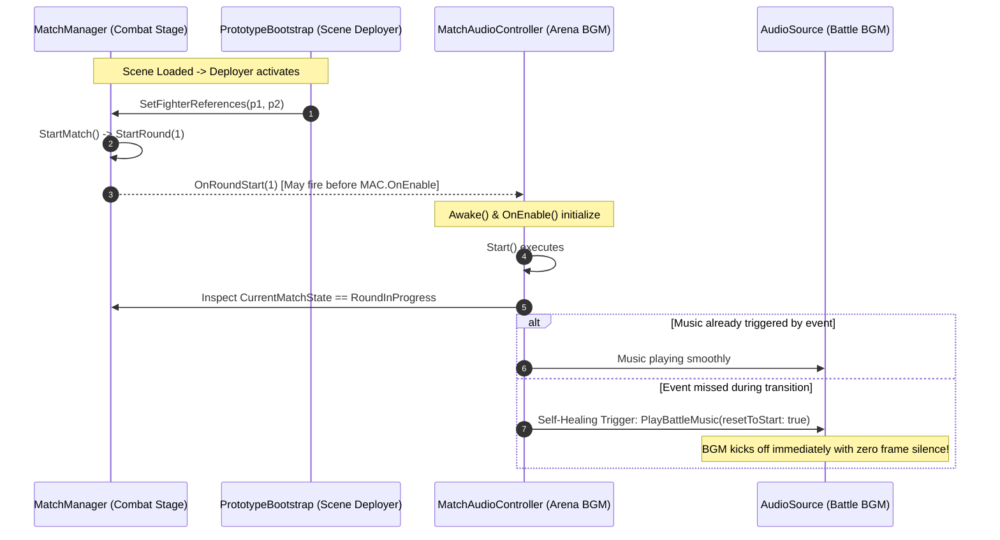

### Architectural Principles:
1. **Scene-Context Filtering Over Global State Enum:**
   - Guarding audio playback with `gameObject.scene.name == "MainMenuScene"` guarantees battle music is isolated from the Title screen, while remaining completely resilient when testing `SampleScene` in isolation.
2. **Double-Safety Handshake (Push Event + Pull State):**
   - The primary trigger is event-driven (`OnRoundStart`).
   - The secondary fallback is state-driven (polling `matchManager.CurrentMatchState == RoundInProgress` in `Start()` and `Update()`).
   - This prevents silent Round 1s under any frame-timing or scene-load order variation.

---

## 20. Dual-Tier Character Transformation & Fallback Architecture (Super Saiyan Mode)

Mystic Combat implements a decoupled, high-resilience transformation system allowing fighters to morph into elevated power forms (such as Goku ascending to Super Saiyan) without duplicating character prefabs, corrupting game loops, or causing missing-sprite crashes.

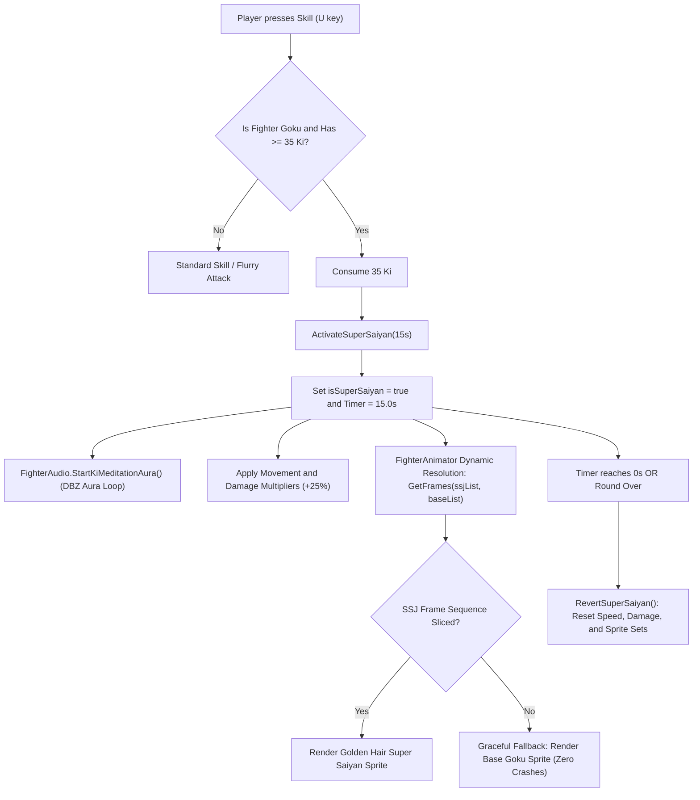

### Architectural Highlights:
1. **Zero-Crash Graceful Fallback (`GetFrames` Pattern):**
   - In traditional sprite systems, switching form sets can throw index out-of-range or null pointer exceptions if an artist hasn't yet exported every single animation for the transformed state (e.g., crouching or jumping).
   - `FighterAnimator.GetFrames(ssjList, baseList)` inspects if `isSuperSaiyan` is true and `ssjList.Count > 0`. If any SSJ sequence is missing, it dynamically falls back to the Base sequence. The game remains 100% playable at all times.
2. **Stat Multiplier Overlay:**
   - Rather than hardcoding separate Super Saiyan stat blocks, `FighterController` uses an operational multiplier (`isSuperSaiyan ? 1.25f : 1.0f`) on linear velocity calculations and hitbox configuration calls.
3. **Round Reset Auto-Reversion:**
   - `FighterController.ResetForNewRound()` explicitly calls `RevertSuperSaiyan()`, guaranteeing fighters spawn in base form at the start of each round.
4. **Godot vs Unity Analogy:**
   - **Godot:** In Godot, you might swap an `AnimatedSprite2D`'s `SpriteFrames` resource or flip an `AnimationTree` blend state.
   - **Unity:** In Unity, `FighterAnimator` dynamically routes frame requests through the cached `Frames_SSJ` list pointers, avoiding asset reloads or disk reads during live 60 FPS combat.

---

## 21. Master VFX & Combat Juice Architecture (`VFXManager.cs` & `FighterKiAura.cs`)

Mystic Combat implements a zero-allocation, pooled Visual Effects engine specifically designed for 60 FPS fighting game responsiveness.

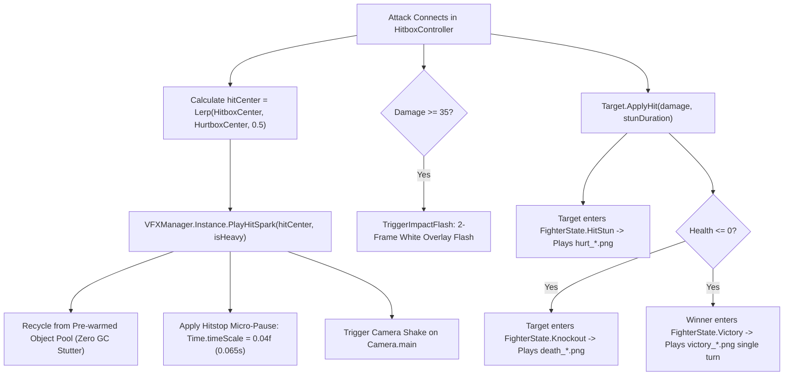

### Key Architectural Pillars:
1. **Pre-warmed Object Pooling:** In a fast fighter, attacks land 3–5 times per second. Spawning `Instantiate()` and `Destroy()` triggers Garbage Collection (GC) pauses that drop frames. `VFXManager` pre-warms 32 particle emitters and shockwave GameObjects in `Awake()`, cycling them through FIFO queues with `SetActive(true/false)`.
2. **Hitstop (Juice / Impact Freeze):** A hallmark of Capcom and Arc System Works fighting games. Freezing the world for 65 milliseconds on heavy impact gives attacks real physical weight and lets the human eye register the collision.
3. **Dynamic Ki Particle Aura (`FighterKiAura.cs`):** A custom particle emitter attached to each fighter that continuously evaluates state:
   - Goku Super Saiyan: Blazing golden flames and rising particles.
   - Base Goku Meditation: Electric cyan Ki flames.
   - Saitama: Menacing crimson pressure aura.
4. **Godot vs Unity Analogy:**
   - **Godot:** In Godot, you'd emit signals to a global `VFX` autoload or instantiate packed scenes (`GPUParticles2D`) and call `queue_free()`.
   - **Unity:** In Unity, `VFXManager.Instance` coordinates pre-warmed `ParticleSystem` components and screen-shake coroutines directly on the main scene camera.

---

## 22. Dramatic Slow-Motion K.O. State Machine & Authentic DBZ Flame Architecture

To achieve authentic arcade fighting game weight and cinematic punch, Mystic Combat replaces abrupt round transitions with a 4-phase decoupled K.O. sequence and an oscillating dual-layer anime flame shell.

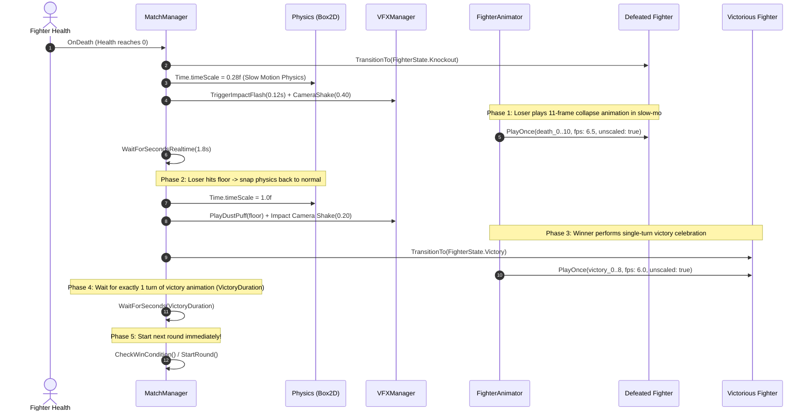

### Architectural Principles:
1. **Decoupled Delta Time (`unscaled: true`):**
   - **The Problem:** Scaling animations with `Time.deltaTime` during a slow-motion knockdown causes frame rate to drop from 60 FPS to 15 FPS, resulting in choppy 3-frame slideshow animations.
   - **The Solution:** In [`FighterAnimator.cs`](file:///B:/Unity/Projects/Mystic_Combat_Animeverse_Incursion/Assets/Scripts/Fighter/FighterAnimator.cs), `PlayOnce` and `PlayLoop` support `unscaled: true` using `Time.unscaledDeltaTime`. Physics (gravity, knockback recoil, debris) moves at $0.28\times$ cinematic speed, while the 11-frame pixel-art collapse plays at a full, fluid framerate over exactly 1.7 real seconds.
2. **Dual-Layer Oscillating DBZ Aura (`FighterKiAura.cs`):**
   - **Layer 1 (Spiky Flame Cocoon):** A high-frequency oscillating sprite shell (`dbz_spiky_aura.png`, 26 jagged flame spires) fluctuating at $24\text{–}28\text{ Hz}$ with dynamic Perlin scaling and alpha pulsation.
   - **Layer 2 (Speed-Streak Sub-Emitter):** Vertical stretched needle particles shooting rapidly upward through the cocoon from the feet past the fighter's head.
   - **Dynamic Color Tinting:** Single-pass tinting allows the grayscale master sprite to project Radiant DBZ Gold (Super Saiyan Goku), Electric Cyan (Base Goku meditation), or Blazing Crimson (Saitama).
3. **Super Saiyan State Guards:**
   - In [`FighterController.cs`](file:///B:/Unity/Projects/Mystic_Combat_Animeverse_Incursion/Assets/Scripts/Fighter/FighterController.cs), meditation is strictly blocked while `isSuperSaiyan` is true (`!isSuperSaiyan`), preventing Goku from generating Ki while ascended.
4. **Pacing Standardization (199s Round Timer):**
   - Set `roundDuration = 199f` in `MatchManager.cs` to eliminate rushed play and provide ample time for footsies, spacing, and dramatic momentum swings.
5. **Godot vs Unity Analogy:**
   - **Godot:** In Godot, you'd set `Engine.time_scale = 0.28`, and mark `process_mode = PROCESS_MODE_ALWAYS` or use `_process(get_process_delta_time())` on an `AnimatedSprite2D` to avoid timescale slowdown.
   - **Unity:** In Unity, `Time.timeScale = 0.28f` governs the physics loop and `Time.deltaTime`, while `Time.unscaledDeltaTime` drives UI and decoupled celebratory sprite sequences.


---

## 24. Re-Entrant HitStop Management & 2D Vector Knockback Architecture

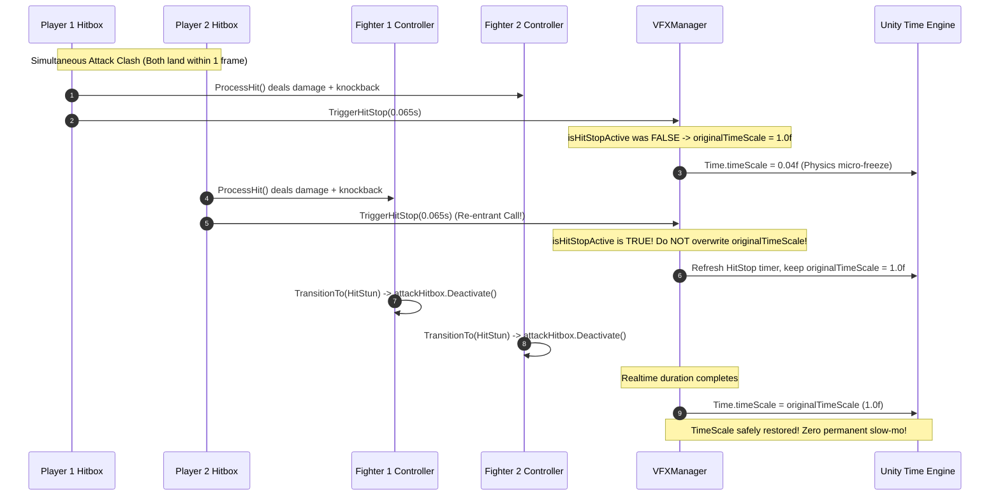

### Architectural Pillars:
1. **Re-Entrant HitStop Guard (`VFXManager.cs`):**
   - Encapsulates `isHitStopActive` state.
   - Prevents nested coroutines from reading an already slowed `Time.timeScale` ($0.04\text{f}$) as the "normal" scale.
   - Restores physics speed safely on completion, interruption, or component disable.
2. **2D Decoupled Knockback (`HitboxController.cs`):**
   - Replaced monolithic vertical lift with parameterized `knockbackY` in `ConfigureAttack(damage, knockbackX, kiGain, offset, size, knockbackY)`.
   - Allows fine-grained control: jabs flinch without floating, heavy strikes send targets reeling, and multi-hit flurries trap opponents in place.
3. **Counter-Hit Attack Interruption (`FighterController.cs`):**
   - In `TransitionTo(newState)`, if entering `HitStun`, `KnockBack`, or `Knockout`, `attackHitbox.Deactivate()` is executed immediately.
   - Prevents lingering hitboxes from hitting after a fighter has already been interrupted.

---

## 23. Dual-Form Character Animation Architecture & Ground Plane Synchronization (`FighterAnimator.cs`)

### Architectural Overview
To support dynamic character transformations (e.g. Goku's transformation from Base to Super Saiyan) without instantiating new GameObjects or causing camera/physics glitches, `FighterAnimator.cs` implements a **Dual-Sequence State Dispatcher**:

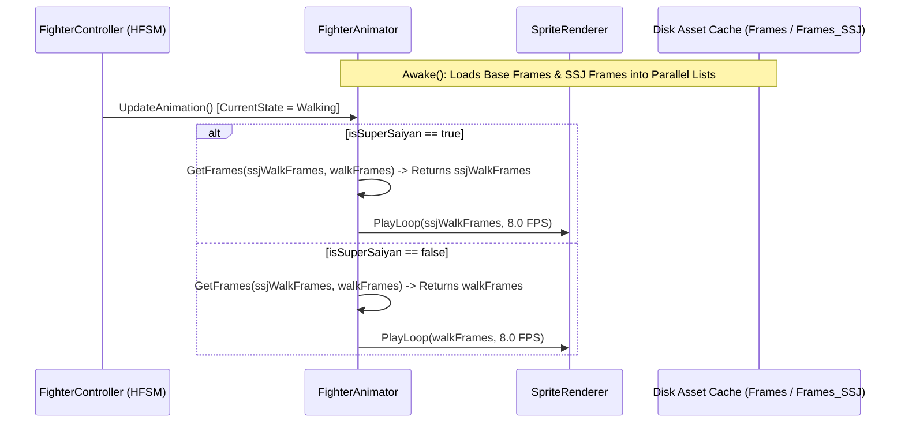

### Architectural Highlights:
1. **Parallel Sequence Loading:**
   - On initialization, `FighterAnimator.cs` loads Base Goku frames from `Assets/Sprites/Fighters/Goku/Frames/` into `idleFrames`, `walkFrames`, etc.
   - Concurrently, if `Frames_SSJ` exists, it populates `ssjIdleFrames`, `ssjWalkFrames`, etc.
   - `GetFrames(ssjList, baseList)` provides instant runtime fallback: if a specific track is empty in SSJ (e.g., `skill` or `ultimate`), it gracefully falls back to the base form's animation without throwing null references.

2. **Standardized Ground Plane Contract ($128 \times 128$, Baseline $Y = 105$):**
   - Both Base and Super Saiyan assets strictly conform to a $128 \times 128$ texture contract with the character's planted feet pinned to $Y = 105$.
   - `LoadFrame()` applies a calculated pivot:
     $$\text{pivot} = \left(0.5f, \frac{128f - 105f}{128f}\right) = (0.5f, 0.1797f)$$
   - This ensures transformation causes zero vertical hopping, zero hitbox drift, and zero floor penetration.


---

## 25. Match Manager Overtime Extension & Simultaneous Death Arbitration Architecture

```mermaid
flowchart TD
    Start["Round Start (199s Timer)"] --> Tick["Tick Round Timer (Update)"]
    Tick --> CheckDeath{"Fighter HP <= 0?"}
    
    CheckDeath -- "Yes (Death Event Fired)" --> WaitFrame["WaitForEndOfFrame() Arbitration"]
    WaitFrame --> BothDead{"Both HP <= 0?"}
    BothDead -- "Yes" --> DoubleKO["Double K.O.! Both Collapse
P1 +1 Pt | P2 +1 Pt
OnRoundEnd(0, round)"]
    BothDead -- "No" --> SingleWin["Single Winner Knockout
Winner +1 Pt
OnRoundEnd(winner, round)"]

    CheckDeath -- "No (Both Alive)" --> TimerZero{"roundTimer <= 0s?"}
    TimerZero -- "No" --> Tick
    TimerZero -- "Yes" --> CheckOT{"isOvertime == false?"}
    CheckOT -- "Yes (Regular Time Over)" --> GrantOT["Grant +100s Overtime!
isOvertime = true
VFX Flash & Camera Shake
HUD Yellow Warning"]
    GrantOT --> Tick
    CheckOT -- "No (Overtime Expired)" --> TimeDraw["Time-Out Draw!
Neither Collapses
P1 +1 Pt | P2 +1 Pt
OnRoundEnd(0, round)"]

    DoubleKO --> CheckWin{"CheckWinCondition()"}
    SingleWin --> CheckWin
    TimeDraw --> CheckWin

    CheckWin -- "Both >= 2 Wins & Tied (2-2)" --> Tiebreak["Sudden Death Final Round!
StartRound()"]
    CheckWin -- "One Player >= 2 Wins" --> MatchOver["Tournament Champion Declared!
OnMatchOver(winner)"]
    CheckWin -- "Neither >= 2 Wins (e.g. 1-1)" --> NextRound["Start Next Round
StartRound()"]
```

### Architectural Principles:
1. **Deferred Death Arbitration (`WaitForEndOfFrame`):**
   - Eliminates execution-order bias during trading blows.
   - Accurately captures simultaneous double-deaths within the same frame tick.
2. **Re-Entrant Draw Representation (`winnerIndex = 0`):**
   - The event signature `OnRoundEnd?.Invoke(winnerPlayerIndex, currentRound)` utilizes `0` to denote a Draw.
   - Listeners ([`HUDController.cs`](file:///B:/Unity/Projects/Mystic_Combat_Animeverse_Incursion/Assets/Scripts/UI/HUDController.cs), [`CombatMenuController.cs`](file:///B:/Unity/Projects/Mystic_Combat_Animeverse_Incursion/Assets/Scripts/UI/CombatMenuController.cs)) seamlessly adapt by lighting both players' score gems and presenting Draw Match victory banners.
3. **Pacing Continuity:**
   - Overtime extensions do not reset health or fighter positions; combat flows uninterrupted with fresh clock pressure.


---

## 26. Kamehameha State Machine Lifecycle & Full-Screen AoE Blast Architecture

```mermaid
sequenceDiagram
    autonumber
    participant Input as Player Input
    participant FC as Goku FighterController
    participant VFX as KamehamehaBeamVFX
    participant Hit as HitboxController
    participant Cam as VFXManager (Camera)
    participant Opp as Opponent Fighter

    Input->>FC: Ultimate Pressed (Q / O, 80 Ki)
    FC->>FC: TransitionTo(FighterState.Ultimate)
    Note over FC: attackTimer = 3.36s | startup = 2.15s | active = 1.21s

    loop Phase 1: Startup Charge (2.15s)
        VFX->>VFX: Position charge orb in cupped hands (-0.35m, 0.88m)
        VFX->>VFX: Swell orb scale (0.20m -> 0.88m) + 30Hz Ki pulse
        Note over FC: Audio: "KA... ME... HA... ME..."
    end

    Note over FC,VFX: Startup Timer reaches 0s -> Eruption!
    FC->>Hit: Activate Hitbox (Offset: 4.6m, Size: 8.5m x 1.6m)
    VFX->>Cam: TriggerCameraShake(0.30, 0.38s) + ImpactFlash(0.04s)
    VFX->>VFX: Deactivate Orb -> Activate Muzzle Flare + Beam Body + Beam Head

    loop Phase 2: Beam Blast (1.21s)
        VFX->>VFX: Roaring plasma oscillation (1.35m - 1.55m thickness)
        Hit->>Opp: Overlap detected! Deal 45 Dmg, 8.5f X / 2.2f Y Knockback
        Note over Hit: Opponent added to hitTargetsThisSwing -> SINGLE HIT!
        Note over FC: Audio: "HA-A-A-A!"
    end

    Note over VFX: activeTimer < 0.20s -> Fade beam alpha (1.0 -> 0.0)
    FC->>Hit: Deactivate Hitbox
    VFX->>VFX: StopAllVFX()
    FC->>FC: TransitionTo(Idle)
```

### Architectural Principles:
1. **Decoupled Visual Component (`KamehamehaBeamVFX.cs`):**
   - Implements a self-contained visual controller attached directly to Goku.
   - Monitors `controller.CurrentState`, `AttackStartupTimer`, and `AttackActiveTimer` to drive visual phases without polluting core movement or state transition logic.
2. **Instant Interruption Cleanup:**
   - If Goku takes damage and transitions to `HitStun` or `Knockout`, `KamehamehaBeamVFX.Update()` detects `CurrentState != Ultimate` and shuts down all active sprites on the exact same frame.
3. **True AoE Beam Alignment:**
   - Visual beam body ($7.2\text{m}$) and leading head ($1.3\text{m}$) yield an $8.5\text{m}$ total reach, perfectly synchronized with `HitboxController.ConfigureAttack(45, 8.5f, 15f, new Vector2(4.6f, 0.95f), new Vector2(8.5f, 1.6f), 2.2f)`.


---

## 42. UI Font Asset Architecture & Self-Healing Distance Field Rendering

### Architectural Problem Statement
In arcade fighting games, UI text must be instantaneous, crisp, and robust across diverse display aspect ratios. A failure in font asset texture binding or glyph coverage results in unreadable solid blocks (tofu quads) during critical moments like match pausing or tournament victory declarations.

### Multi-Layered Defense-in-Depth Pipeline

```mermaid
flowchart TD
    subgraph Layer 1: Serialized Assets
        F1["ArcadeClassic_SDF.asset<br/>_MainTex = fileID -3925478913968619439"]
        F2["RetroGaming_SDF.asset<br/>_MainTex = fileID -1603636736672497938"]
        FB["Fallback Table<br/>LiberationSans SDF (GUID: 8f5863...)"]
        F1 --> FB
        F2 --> FB
    end

    subgraph Layer 2: Asset Storage
        R1["Assets/Resources/Fonts/"]
        R2["Assets/Fonts/TMP_Assets/"]
    end

    subgraph Layer 3: Runtime Self-Healing
        CM["CombatMenuController.cs"]
        EI["EnsureFontIntegrity(font)"]
        SH["SanitizeAndHealUIHierarchy()"]
        CM --> EI
        CM --> SH
    end

    subgraph Layer 4: Screen Output
        TXT["Crisp Retro Glyphs<br/>> RESUME <<br/>- COMBAT FROZEN -<br/>* WORLD CHAMPION *"]
    end

    Layer 1 --> Layer 2
    Layer 2 --> Layer 3
    Layer 3 --> Layer 4
```

### Self-Healing Runtime Architecture:
1. **Material Texture Verification (`EnsureFontIntegrity`):**
   Checks `font.material.GetTexture("_MainTex")`. If null, immediately re-links `font.material.SetTexture("_MainTex", font.atlasTexture)`.
2. **Dynamic Fallback Assignment:**
   If `font.fallbackFontAssetTable` is missing, dynamically appends `LiberationSans SDF` (which has complete ASCII and Latin-1 coverage).
3. **Typography Sanitization (`SanitizeAndHealUIHierarchy`):**
   Traverses all `TextMeshProUGUI` components on active and inactive menu roots. Sanitizes non-ASCII Unicode glyphs (`▶`, `◀`, `★`, `—`, `•`) into universal ASCII (`>`, `<`, `*`, `-`, `|`) and calls `label.ForceMeshUpdate()`.
4. **Hierarchy Auto-Wiring:**
   If `pauseMenuRoot` or `resultsMenuRoot` exists in the scene prefab without inspector button bindings, dynamic hierarchy traversal populates button lists and registers click listeners automatically.
5. **Dynamic Typography Scaling & Pause Key Isolation:**
   - In `EnsureUIHierarchyBuilt()`, secondary victory elements (`Micro_Header`, `Epithet_Text`, `Score_Text`, `Footer_Hints`) are checked and scaled up to $\ge 15.0\text{pt} - 22.0\text{pt}$ at runtime, ensuring crisp readability on $1080\text{p}$ and $4\text{K}$ screens.
   - Pause detection is strictly isolated to `Keyboard.escapeKey.wasPressedThisFrame`, eliminating input collisions with Player 2's right-hand cluster or player attacks.


---

## 25. Dynamic 3-Round Stage Evolution & Environmental VFX Architecture (`ArenaBackgroundManager.cs`)

### System Architecture Diagram
```mermaid
flowchart TD
    MM[MatchManager.cs] -->|OnRoundStart(roundNumber)| ABM[ArenaBackgroundManager.cs]
    
    subgraph Arena Environmental Subsystems
        ABM -->|Crossfade Stage| BD[Backdrop Renderers]
        ABM -->|Switch Palette & Surge| BZ[Brazier Flame Animators]
        ABM -->|Adjust Rate & Color| PS[Ember Particle Systems]
        ABM -->|Toggle & Rotate| MD[Doctor Strange Tao Mandala]
        ABM -->|Activate Cosmic Field| CD[Cosmic Dust Particle Field]
    end

    subgraph Combat Juice Event Coupling
        VFX[VFXManager.cs] -->|TriggerBrazierSurge(1.4f)| ABM
        HB[HitboxController / Ultimates] -->|Heavy Hit / Beam Flash| VFX
    end

    subgraph Round Visual States
        BD --> R1["Round 1: Grand Martial Arts Tournament<br/>(Pagodas, Mountains, Orange Fire)"]
        BD --> R2["Round 2: Battle on the Moon<br/>(Crater Surface, Planet Earth, Blue Plasma)"]
        BD --> R3["Round 3: Multiverse Cataclysm<br/>(Mirror Dimension Shatter, Saiyan Gold Ki)"]
    end
```

### Architectural Principles:
1. **Event-Driven Decoupled Synchronization:**
   `ArenaBackgroundManager` does not poll `matchManager.CurrentRound` every frame in `Update()`. Instead, it hooks into `MatchManager.OnRoundStart` via a C# delegate event (equivalent to a Signal in Godot), executing state transitions strictly when a round initiates.
2. **Dual-Renderer Alpha Cross-Fading:**
   To transition smoothly between distinct round backdrops without harsh cuts:
   - `primaryBackdrop` displays the current stage at $\alpha = 1.0$.
   - `crossfadeBackdrop` displays the upcoming stage starting at $\alpha = 0.0$ and lerps to $\alpha = 1.0$ over $1.2\text{s}$.
   - Upon completion, `primaryBackdrop` assumes the new texture, and `crossfadeBackdrop` resets to transparent.
3. **Interactive Combat Juice Coupling:**
   `VFXManager` communicates with `ArenaBackgroundManager.Instance?.TriggerBrazierSurge(multiplier)` during heavy hitsparks, screen shakes, and impact flashes. The braziers momentarily scale up by $140\%$ and burst $12$ extra embers into the air, making the environment physically react to combat momentum.
4. **Zero-GC Frame Caching:**
   Flame sprites (`Orange`, `Blue`, `Gold`) are loaded into pre-allocated memory lists during `Awake()`. Switching palettes changes list references with zero garbage collection allocations during combat frames.


---

## 43. Kinetic Combat Physics, Gatling Chain Cancels & Red Zone Vulnerability Architecture

### System Architecture Diagram
```mermaid
sequenceDiagram
    autonumber
    actor Player as Player Input
    participant FC as Attacker FighterController
    participant HC as HitboxController
    participant T_HS as Target HealthSystem
    participant T_ES as Target EnergySystem
    participant T_FC as Target FighterController
    participant VFX as VFXManager

    Player->>FC: LightAttackPressed
    FC->>FC: ExecuteLightAttack() [Dmg: 3 or 4, Startup: 0.08s]
    FC->>HC: ConfigureAttack & Activate()
    
    HC->>T_HS: TakeDamage(baseDmg)
    T_HS->>T_ES: Check IsInRedZone
    alt Target In Red Zone (Exhausted)
        T_ES-->>T_HS: true
        Note over T_HS: amount = round(baseDmg * 1.35) [+35% Danger Multiplier]
    else Normal Ki State
        T_ES-->>T_HS: false
    end
    T_HS->>T_HS: currentHealth -= amount

    HC->>FC: OnAttackHitConfirmed() [sets hasHitTargetThisSwing = true]
    HC->>VFX: PlayHitSpark() & MicroHitStop()
    HC->>T_FC: ApplyHit(damage, stun: 0.22s)
    alt Target In Red Zone
        Note over T_FC: stunDuration += 0.12s (0.34s Total Stagger)
    end

    Note over FC: Active / Recovery Cancel Window Open!
    Player->>FC: HeavyAttackPressed / SkillPressed
    opt hasHitTargetThisSwing == true
        FC->>FC: ExecuteHeavyAttack() / ExecuteSkillAttack() [Chain Cancel!]
        Note over FC: Light recovery instantly aborted into Heavy strike!
    end
```

### Architectural Principles:
1. **Hit Confirm Callback Pipeline (`OnAttackHitConfirmed`):**
   - Traditional fighting games implement complex frame buffers to handle cancels.
   - Mystic Combat uses a lightweight decoupled event callback: `HitboxController.ResolveHit()` explicitly notifies `ownerFc.OnAttackHitConfirmed()`.
   - `FighterController` uses this state flag strictly during the `LightAttack` active/recovery window to allow instantaneous transitions into `HeavyAttack` or `Skill`.
   - `TransitionTo()` resets `hasHitTargetThisSwing = false` on every state switch, preventing stale cancel buffers.

2. **Decoupled Vulnerability Scaling in `HealthSystem`:**
   - Rather than forcing every individual hitbox to evaluate whether a target is exhausted, vulnerability is centralized inside `HealthSystem.TakeDamage()`.
   - Inspecting `energySystem.IsInRedZone` at the point of damage calculation guarantees that all damage sources (basic jabs, heavy strikes, kamehameha beams, and serious punches) scale uniformly by $+35\%$ without duplicating logic across scripts.

3. **Kinetic Deceleration & Asymmetrical Gravity:**
   - In `FixedUpdate()`, knockback decay runs independently of horizontal movement inputs:
     $$\Delta V_x = \text{MoveTowards}(V_x, 0, 14 \cdot \Delta t)$$
   - Gravity switching uses sign evaluation on $V_y$:
     $$g_{\text{eff}} = \begin{cases} g \times 1.35, & \text{if } !IsGrounded \land V_y < 0 \\ g, & \text{otherwise} \end{cases}$$
   - This keeps horizontal deceleration and vertical arc gravity modular and easily tweakable.


---

## 44. Anti-Stacking Capsule Physics, Bulldoze Lock & Vertical Hit Clearance Architecture

### System Architecture Diagram
```mermaid
flowchart TD
    subgraph Input & Movement Resolution
        IN[Player Movement Input] --> AM[FighterController.ApplyMovement]
        OPP[Opponent Transform] --> AM
        AM -->|dx <= 1.15m && movingTowards| LOCK[Clamp horizontalVelocity = 0<br/>Immovable Sparring Barrier]
        AM -->|dx > 1.15m || movingAway| FREE[Normal Speed Application]
    end

    subgraph Vertical Capsule & Anti-Stacking
        BC[CapsuleCollider2D: 1.10m x 1.45m] -->|Curved Upper Dome| DOME[Angled Normal Deflection]
        KP[FighterController.ApplyKineticPhysics] -->|dy > 0.70m && |dx| < 0.95m| SLIP[Apply 3.0 m/s Outward Slip Vector<br/>Zero Head Stacking]
    end

    subgraph Duckable Hitbox & Hurtbox Matrix
        CR[FighterState.Crouching] -->|size: 0.75x0.65, offset: 0, 0.35| CH[Top Edge Y = 0.675m]
        LA[Light Attack Hitbox] -->|size: 0.75x0.45, offset: 0.80, 1.05| L_BOT[Bottom Edge Y = 0.825m]
        HA[Heavy Attack Hitbox] -->|size: 0.82x0.48, offset: 0.84, 1.05| H_BOT[Bottom Edge Y = 0.810m]
        L_BOT -.->|Clearance: 0.150m (Whiff)| CH
        H_BOT -.->|Clearance: 0.135m (Whiff)| CH
    end
```

### Architectural Principles:
1. **Kinematic Proximity Clamping (`minFighterGap`):**
   - By calculating `dx = opponent.position.x - transform.position.x` directly inside `ApplyMovement()`, the engine detects when a fighter is attempting to walk into an already-occupied space.
   - Forward horizontal velocity is clamped to $0$ without disabling backward velocity, ensuring fighters stop upon body contact rather than pushing each other across the floor.
2. **Deflection via Capsule Geometry & Active Slip Vector:**
   - Physical bodies use a waist-high vertical `CapsuleCollider2D` ($1.10\text{m} \times 0.90\text{m}$).
   - An active slip vector in `ApplyKineticPhysics()` enforces that any airborne body descending directly centered over opponent ($|dx| < 0.45\text{m}$, $0.40\text{m} < dy < 1.05\text{m}$) receives an outward horizontal velocity impulse ($\pm 2.5\text{ m/s}$), preventing vertical equilibrium on top of character colliders.
3. **Deterministic Vertical Hit Clearance:**
   - Both Light ($Y_{\text{bottom}} = 0.825\text{m}$) and Heavy ($Y_{\text{bottom}} = 0.810\text{m}$) attack hitboxes have their lower bound safely elevated above the ducking hurtbox apex ($Y = 0.675\text{m}$), establishing a clean ducking dodge hierarchy.


---

## 45. Strict Hurtbox Layering, Waist-High Push Boxes & Cross-Over Architecture

### System Architecture Diagram
```mermaid
flowchart TD
    subgraph Attack Resolution Pipeline
        HB[HitboxController.ProcessHit] --> CQ{Check other.GetComponent HurtboxController}
        CQ -->|null: Body Capsule, GroundCheck, World| REJ[Reject Collision<br/>Zero Damage, Clean Whiff]
        CQ -->|not null: Valid Hurtbox| ACC[Accept Collision]
        ACC --> HS[HealthSystem.TakeDamage]
    end

    subgraph Movement & Air Cross-Over System
        IN[Movement Input] --> AM[FighterController.ApplyMovement]
        AM --> GC{Check IsGrounded}
        GC -->|true && movingTowards && dx <= 1.15m| CLAMP[Clamp horizontalVelocity = 0<br/>Immovable Ground Barrier]
        GC -->|false: Jumping / Falling| AIR[Preserve Full Horizontal Velocity<br/>Unrestricted Cross-Over Arcs]
    end

    subgraph Separation of Physics Body vs Dynamic Hurtbox
        ST[Fighter State] --> DYN[FighterController.TransitionTo]
        DYN -->|Body Capsule: STATIC| BODY["Fixed CapsuleCollider2D (1.10m x 0.90m, Y_top = 0.90m)<br/>Zero Runtime Resizing -> Prevents Box2D Depenetration Jumping"]
        DYN -->|Crouching Hurtbox| C_HURT["Hurtbox Trigger: (0.75m x 0.65m, Y_top = 0.675m)"]
        DYN -->|Standing Hurtbox| S_HURT["Hurtbox Trigger: (0.85m x 1.80m, Y_top = 1.85m)"]
    end
```

### Architectural Principles:
1. **Strict Hurtbox Contract Enforcement:**
   - Decouples combat damage reception completely from physics movement bodies.
   - `HitboxController` explicitly checks `HurtboxController`. Touching `CapsuleCollider2D`, stage walls, or internal sensors produces immediate rejection.
2. **Grounded-Exclusive Proximity Clamping:**
   - `dx <= 1.15m` velocity clamping is strictly predicated on `IsGrounded`.
   - Airborne bodies maintain linear momentum across the horizontal axis, resolving the mid-air freeze bug and enabling cross-ups.
3. **Waist-Level Push-Box Anchoring (Static Collider Architecture):**
   - Physical movement bodies are capped at waist height ($0.90\text{m}$) and kept **static** at runtime. Dynamically resizing dynamic `Rigidbody2D` colliders while resting on the floor causes Box2D depenetration impulses that catapult the character into the air (the "infinite jumping" bug).
   - Character jump heights ($1.98\text{m}\text{--}2.65\text{m}$) clear this $0.90\text{m}$ waist geometry with over $1.0\text{m}\text{--}1.75\text{m}$ of vertical clearance.
   - Character jump heights ($1.98\text{m}\text{--}2.65\text{m}$) clear this geometry with substantial margins.


---

## 47. Cinematic Ultimate Architecture & Multi-Layered Visual Cut-In Pipeline (`SaitamaSeriousPunchCinematic.cs`)

### System Architecture Diagram
```mermaid
sequenceDiagram
    autonumber
    actor Player as Player Input (X / M)
    participant FC as FighterController (State: Ultimate)
    participant Cin as SaitamaSeriousPunchCinematic
    participant Spr as SpriteRenderer (FighterAnimator)
    participant Void as BlackVoid_Canvas (ScreenSpaceOverlay)
    participant VFX as VFXManager
    participant Hit as HitboxController

    Player->>FC: ExecuteUltimateAttack() (Spends 80 Ki)
    FC->>FC: attackStartupTimer = 2.40s, attackActiveTimer = 1.40s
    FC->>FC: TransitionTo(FighterState.Ultimate)
    FC->>Spr: Play frames 0..5 (Stance drop & deep coiling windup)
    FC->>Spr: Play frame 6 (Standing braced transitional frame)

    Note over FC,Cin: Startup Expires at 0.0s ("SERIOUS PUNCH!")
    Cin->>Void: Activate 100% Solid Pitch-Black Void (sortingOrder = 950)
    Cin->>Void: Display Enlarged Punch Cut-In (720x628px, clamped <= Saitama X)
    Note over Cin,Void: 0.28s Arcade Super Freeze (Time.unscaledDeltaTime)
    Cin->>Void: Deactivate Black Void & Cut-In (Instant Snap-Back!)

    Note over FC,Spr: Normal Arena Resumes
    FC->>Spr: Play frames 7..13 (Normal physical strike burst & recovery)
    Cin->>VFX: TriggerImpactFlash(0.055s) & TriggerCameraShake(0.38f, 0.32f)
    FC->>Hit: Activate Hitbox (1.4m x 1.0m, Short Melee Reach)
    Hit-->>Player: Resolve Decisive 90 Damage Strike
```

### Architectural Principles:
1. **Decoupled Dual-Layer Presentation:**
   `SaitamaSeriousPunchCinematic` operates as an independent observer on the character. It never interferes with `FighterAnimator`'s base frame playback or `FighterController`'s state machine. The cinematic super freeze is rendered strictly via a decoupled Screen-Space Canvas (`sortingOrder = 950`) that appears for $0.28\text{s}$ before snapping back cleanly to the normal arena.
2. **Dynamic Screen-Space Framing:**
   The Big Punch cut-in coordinates are dynamically calculated via `Camera.main.WorldToViewportPoint(transform.position)`. The cut-in is placed towards screen center and oriented in Saitama's facing direction, while mathematically clamped so its back edge **never exceeds Saitama's $X$ coordinate backwards** and stays safely inside viewport bounds.
3. **Re-Ordered Physical Frame Sequencing:**
   The physical sprite frames (`ultimate_0` through `ultimate_13`) represent an uninterrupted martial arts sequence: crouch $\rightarrow$ deep coil $\rightarrow$ braced transition (frame 6) $\rightarrow$ strike release $\rightarrow$ recovery.
4. **Hitbox Range Discipline:**
   The damaging collision shape is kept strictly to `new Vector2(1.4f, 1.0f)` offset at `(1.25f, 0.95f)`. This guarantees that opponents outside close melee range remain completely safe, preserving competitive balance.


---

## 48. Mirror Match Architecture: Persistent Base Tinting, Cross-System Visual Pipeline & Single Source of Truth

### System Architecture Diagram
```mermaid
flowchart TD
    subgraph Single Source of Truth
        SSOT["FighterController.GetAlternatePaletteColor(characterId)"]
        GOKU["Goku P2: Cool Cyan/Ice (0.45, 0.75, 1.0, 1.0)"]
        SAITAMA["Saitama P2: Fiery Sunset/Crimson (1.0, 0.50, 0.45, 1.0)"]
        SSOT --> GOKU
        SSOT --> SAITAMA
    end

    subgraph Character Selection Layer
        CS[CharacterSelectController] -->|p1Id == p2Id| CS_MIRROR{Is Mirror Match?}
        CS_MIRROR -->|true| CS_BADGE["Update Card Badge: [ P2: ALT PALETTE ]"]
        CS_MIRROR -->|true| CS_VS["Versus Screen: Tint versusP2AvatarImage<br/>Append [ALT] to P2 Name"]
    end

    subgraph Match Bootstrap Layer
        BOOT[PrototypeBootstrap.DeployFighters] -->|p1Char == p2Char| B_MIRROR{Is Mirror Match?}
        B_MIRROR -->|true| FC2["FighterController.SetBaseTintColor(altColor)"]
        FC2 --> STORE["Store in baseTintColor field"]
        B_MIRROR -->|true| HUD["HUDController.SyncFighterAvatarsAndNames"]
        HUD --> HUD_TINT["UpdateAvatarCard: Tint p2AvatarCard with altColor"]
    end

    subgraph Runtime Combat Render Loop
        STORE --> UPD["FighterController.Update()"]
        UPD --> RZ["FighterController.HandleRedZoneVisuals()"]
        RZ -->|IsInRedZone = true| PULSE["Lerp(baseTintColor, DangerRed, pulse)"]
        RZ -->|IsInRedZone = false| RESTORE["spriteRenderer.color = baseTintColor<br/>(Guarantees Zero Wipeout!)"]
        MM_RESET["MatchManager.ResetRound()"] --> FC_RESET["FighterController.ResetForNewRound()"]
        FC_RESET --> RESTORE
    end

    SSOT -.-> CS_VS
    SSOT -.-> FC2
    SSOT -.-> HUD_TINT
```

### Architectural Principles:
1. **Single Source of Truth (`GetAlternatePaletteColor`):**
   Alternate palette definitions are defined centrally in `FighterController.GetAlternatePaletteColor()`. Both UI layers (`CharacterSelectController`, `HUDController`) and in-world systems (`PrototypeBootstrap`, `FighterController`) pull from this canonical source, preventing color divergence.
2. **Persistent Baseline State (`baseTintColor`):**
   `FighterController` encapsulates `baseTintColor` as a first-class state variable. Dynamic runtime effects—such as Red Zone exhaustion pulsing or Super Saiyan aura transitions—throb relative to `baseTintColor` rather than hardcoding `Color.white`.
3. **Round-Persistent Integrity:**
   During round resets (`ResetForNewRound()`), `spriteRenderer.color` is restored directly to `baseTintColor`, ensuring Player 2 retains their alternate tournament identity across all rounds without re-triggering bootstrap routines.
4. **End-to-End Visual Synchronization:**
   The alternate palette is reflected consistently across:
   - The Character Select hover/selection cards.
   - The cinematic Versus screen fly-in.
   - The in-world fighting arena character sprite.
   - The in-combat top-bar HUD avatar bust.


---

# 26. Combat Resource Economy, Transformation State Machine & Interruption Pipeline

### Architecture Diagram: Anti-Spam, Active Toggle Drain & Interruption Pipeline

```mermaid
sequenceDiagram
    autonumber
    participant Input as PlayerInputHandler
    participant FC as FighterController
    participant ES as EnergySystem
    participant Audio as FighterAudio (voiceSource)
    participant Hit as HitboxController
    participant Health as HealthSystem

    rect rgb(30, 41, 59)
    Note over Input,FC: 1. Goku Super Saiyan Toggle & Drain
    Input->>FC: SkillPressed (Key Z / U)
    FC->>FC: Check skillCooldownTimer <= 0f
    alt Base Form (Toggle ON)
        FC->>FC: ActivateSuperSaiyan()
        FC->>Audio: StartKiMeditationAura() (Looping Hum)
        loop Every Frame in Update()
            FC->>ES: SpendKi(2.5f * Time.deltaTime)
            opt Ki <= 0f (Exhaustion)
                FC->>FC: RevertSuperSaiyan()
                FC->>FC: skillCooldownTimer = 15.0f
            end
        end
    else Super Saiyan Form (Toggle OFF)
        FC->>FC: RevertSuperSaiyan()
        FC->>Audio: StopKiMeditationAura()
        FC->>FC: skillCooldownTimer = 15.0f
    end
    end

    rect rgb(15, 23, 42)
    Note over Input,FC: 2. Climax Invulnerability & Super Armor
    Input->>FC: UltimatePressed (Spend Ki, Start Cooldown: 15s)
    FC->>FC: attackStartupTimer = 2.40s
    Note over FC: Countdown reaches <= 1.0s -> IsInvulnerable = true!
    Hit->>FC: Opponent Attack Connects
    Hit->>Health: Check targetHealth.IsInvulnerable
    Note over Hit,Health: Invulnerability Active: Zero Damage, Zero Flinch!
    end

    rect rgb(30, 20, 20)
    Note over Hit,Audio: 3. Interruption Voice Cancellation
    Hit->>Health: Normal Hit Connects (Vulnerable State)
    Health->>FC: ApplyHit()
    FC->>FC: TransitionTo(FighterState.HitStun)
    FC->>Audio: StopVoice() (Halts ongoing dialogue instantly!)
    FC->>Audio: PlayVoiceHurt() (Plays hurt grunt)
    end
```

### Architectural Principles:
1. **Decoupled Continuous Drain vs One-Shot Costs:**
   Instant abilities (like Saitama's Consecutive Normal Punches) draw an upfront cost ($30\text{ Ki}$). Transformation buffs (Goku's Super Saiyan) operate on a per-second drain pipeline ($2.5\text{ Ki/s}$) evaluated inside the core physics tick, cleanly handling auto-reversion upon energy exhaustion.
2. **State-Driven Cooldown Enforcement:**
   Cooldown timers (`skillCooldownTimer`, `ultimateCooldownTimer`) are managed independently of the character's active animation state machine. Toggling off a buff starts the cooldown immediately, preventing rapid toggle-flickering.
3. **Dedicated Voice Channel vs SFX Channel Separation:**
   SFX sounds (punches, swishes, hitsparks) require polyphonic overlap (`PlayOneShot`). In contrast, vocal cords are physically monophonic: a character cannot shout a battle cry and gasp in pain simultaneously. Routing dialogue to a dedicated `voiceSource` enables clean preemption and immediate cutoff on damage interruption.

---

## 49. Visual Tactical Feedback: The 4-Tier Segmented Ki Meter System

### System Architecture
The 4-tier segmented Ki meter replaces monolithic gauge rendering with a **multi-image sub-interval pipeline** calibrated dynamically to character energy costs.

```mermaid
graph TD
    subgraph Character Config ["Character Definition (JSON / Controller)"]
        RedThreshold["RedZoneThreshold = 10 Ki"]
        SkillCost["SkillCost: 35 Ki (Goku) / 20-30 Ki (Saitama)"]
        UltCost["UltCost: 70-80 Ki (Goku) / 100 Ki (Saitama)"]
    end

    subgraph Calibration ["HUDController.CalibrateKiThresholds()"]
        M1["Mark 1 = 10 Ki (10%) [Danger Threshold]"]
        M2["Mark 2 = Red + Skill (45% Goku / 30% Saitama) [Safe Skill]"]
        M3["Mark 3 = Red + Ult (90%) [Safe Ultimate]"]
    end

    subgraph Visual Render ["SegmentContainer Hierarchy (514px x 18px)"]
        RedSeg["KiFill_Red (Color: #FF3838)"]
        GreenSeg["KiFill_Green (Color: #33F259)"]
        BlueSeg["KiFill_Blue (Color: #1FC0FF)"]
        YellowSeg["KiFill_Yellow (Color: #FFE02E)"]
        Notch1["Mark_RedZone (3px x 26px Platinum Notch)"]
        Notch2["Mark_SkillSafe (3px x 26px Platinum Notch)"]
        Notch3["Mark_UltimateSafe (3px x 26px Platinum Notch)"]
    end

    CharacterConfig --> Calibration
    Calibration --> VisualRender
```

### Mathematical Pipeline for Fill Clamping
Given current Ki $K \in [0, K_{\max}]$ and calibrated thresholds $T_1, T_2, T_3$:
$$f_{\text{red}} = \text{clamp}_{0}^{1}\left(\frac{K}{T_1}\right)$$
$$f_{\text{green}} = \begin{cases} 0 & K \le T_1 \\ \text{clamp}_{0}^{1}\left(\frac{K - T_1}{T_2 - T_1}\right) & K > T_1 \end{cases}$$
$$f_{\text{blue}} = \begin{cases} 0 & K \le T_2 \\ \text{clamp}_{0}^{1}\left(\frac{K - T_2}{T_3 - T_2}\right) & K > T_2 \end{cases}$$
$$f_{\text{yellow}} = \begin{cases} 0 & K \le T_3 \\ \text{clamp}_{0}^{1}\left(\frac{K - T_3}{K_{\max} - T_3}\right) & K > T_3 \end{cases}$$

### Dynamic Anchoring & Mirrored Coordinate Symmetry
Each segment's `RectTransform` is anchored as follows:
- **Player 1 (Left-to-Right):**
  - Red: $[0, \frac{T_1}{100}]$, Green: $[\frac{T_1}{100}, \frac{T_2}{100}]$, Blue: $[\frac{T_2}{100}, \frac{T_3}{100}]$, Yellow: $[\frac{T_3}{100}, 1]$
  - Marks: Anchored at $X = \frac{T_i}{100}$
  - `Image.fillOrigin = Image.OriginHorizontal.Left`
- **Player 2 (Mirrored Right-to-Left):**
  - Red: $[1 - \frac{T_1}{100}, 1]$, Green: $[1 - \frac{T_2}{100}, 1 - \frac{T_1}{100}]$, Blue: $[1 - \frac{T_3}{100}, 1 - \frac{T_2}{100}]$, Yellow: $[0, 1 - \frac{T_3}{100}]$
  - Marks: Anchored at $X = 1 - \frac{T_i}{100}$
  - `Image.fillOrigin = Image.OriginHorizontal.Right`


---

## 49. LAN Multiplayer Architecture: Host-Authoritative Simulation, Decoupled Input Bridge & Zero-Allocation Packet Framing

### Architectural Overview
Multiplayer fighting games require ultra-low latency ($< 5\text{ms}$) and absolute state consistency to prevent hit detection discrepancies. Mystic Combat implements a **Host-Authoritative State Mirroring Architecture** using native C# `.NET Sockets` (`TcpListener` on Host, `TcpClient` on Client) with `NoDelay = true` for zero-buffer transmission.

```mermaid
flowchart TD
    subgraph HostPC ["Host Machine (PC 1 - Master Authority)"]
        H_Input["P1: PlayerInputHandler (Local Keyboard)"]
        H_NetInput["P2: NetworkFighterInput (Buffered Stream)"]
        H_Sim["Simulation Engine (Physics, Hitboxes, Health, MatchManager)"]
        H_Sync["NetworkMatchSynchronizer (Host Broadcast 60Hz)"]
        H_NetMgr["LanNetworkManager (TcpListener Port 7777)"]

        H_Input --> H_Sim
        H_NetInput --> H_Sim
        H_Sim --> H_Sync
        H_Sync --> H_NetMgr
    end

    subgraph ClientPC ["Client Machine (PC 2 - Input Streamer & Screen Mirror)"]
        C_Input["P2: Local Keyboard Input Collector (WASD / Arrows)"]
        C_Sync["NetworkMatchSynchronizer (Client Mirror)"]
        C_NetMgr["LanNetworkManager (TcpClient)"]
        C_Mirror["Kinematic Fighter Presentation (Sprites, State, HUD)"]

        C_Input --> C_NetMgr
        C_NetMgr --> C_Sync
        C_Sync --> C_Mirror
    end

    H_NetMgr -- "MatchSnapshotPacket (38 Bytes @ 60Hz)" --> C_NetMgr
    C_NetMgr -- "FighterInputPacket (9 Bytes @ 60Hz)" --> H_NetMgr
```

### Key Architectural Pillars

#### 1. Decoupled Input Architecture (`IFighterInput` Bridge)
Because `FighterController.cs` depends solely on the `IFighterInput` interface rather than reading hardware directly, the host machine swaps out the local input provider for `NetworkFighterInput`:
```csharp
public interface IFighterInput
{
    Vector2 MoveInput { get; }
    bool JumpPressed { get; }
    bool CrouchHeld { get; }
    bool LightAttackPressed { get; }
    bool HeavyAttackPressed { get; }
    bool SkillPressed { get; }
    bool UltimatePressed { get; }
    bool MeditateHeld { get; }
}
```
When `LanNetworkManager.OnRemoteInputReceived` fires on the Host, `NetworkFighterInput.FeedInput()` buffers the remote commands. On the next frame, `FighterController` executes the moves identically to a local player with 0 code branch penalties.

#### 2. Compact Binary Packet Protocol
To prevent garbage collection allocation and ensure minimal MTU utilization, all network traffic is framed into discrete binary packets with a 3-byte header:
$$\text{Packet Format} = [\text{Type}: 1\text{ byte}] [\text{Payload Length}: 2\text{ bytes}] [\text{Payload}: N\text{ bytes}]$$

| Packet Type | Opcode | Size | Payload Description | Frequency |
| :--- | :---: | :---: | :--- | :--- |
| `FighterInput` | `0x04` | $9\text{ B}$ | `Vector2 MoveInput` ($8\text{B}$) + $1\text{B}$ button bitmask (Jump, Crouch, Light, Heavy, Skill, Ult, Meditate). | $60\text{Hz}$ (Client $\rightarrow$ Host) |
| `MatchSnapshot` | `0x05` | $38\text{ B}$ | Round ($1\text{B}$), Timer ($4\text{B}$), MatchState ($1\text{B}$), Wins ($2\text{B}$), P1 State ($15\text{B}$), P2 State ($15\text{B}$). | $60\text{Hz}$ (Host $\rightarrow$ Client) |
| `CharSelectSync`| `0x02` | $\sim 12\text{ B}$| PlayerIndex ($1\text{B}$), CharacterId string, LockedIn bool. | On Selection Change |
| `MatchStart` | `0x03` | $\sim 16\text{ B}$| P1 & P2 finalized CharacterId strings. | On Match Launch |

#### 3. Kinematic Client Mirroring (Zero Physics Drift)
In fighting games, dual physics simulations will inevitably drift due to sub-pixel floating-point rounding. On the Client machine, `NetworkMatchSynchronizer` automatically sets both fighters' `Rigidbody2D` components to `isKinematic = true` and deactivates local `HitboxController` scripts:
- **Authority:** All hit registration, knockback, damage scaling, and Red Zone exhaustion occur exclusively on the Host.
- **Client Presentation:** The Client receives authoritative positions $(X, Y)$, linear velocities $(V_x, V_y)$, health, Ki, facing flips, and active `FighterState` values, ensuring flawless visual mirroring with zero desyncs.

#### 4. Thread-Safe Unity Dispatch (`ConcurrentQueue<Action>`)
Network streaming threads cannot call Unity API methods directly without triggering `InvalidOperationException`. `LanNetworkManager` utilizes a thread-safe `ConcurrentQueue<Action>`:
1. Incoming socket thread decodes binary packets and enqueues lambda dispatchers.
2. In `LanNetworkManager.Update()`, the main thread drains the queue and fires C# events safely within Unity's execution cycle.
