# 02. System Architecture & Design Patterns

> **Audience:** Core team developers, code reviewers, and viva / project defense evaluators.

---

## 1. High-Level Architectural Diagram

Mystic Combat is designed around **decoupled, modular components** communicating via **Data Contracts** and **C# Events**. No monolithic "Player" script exists.

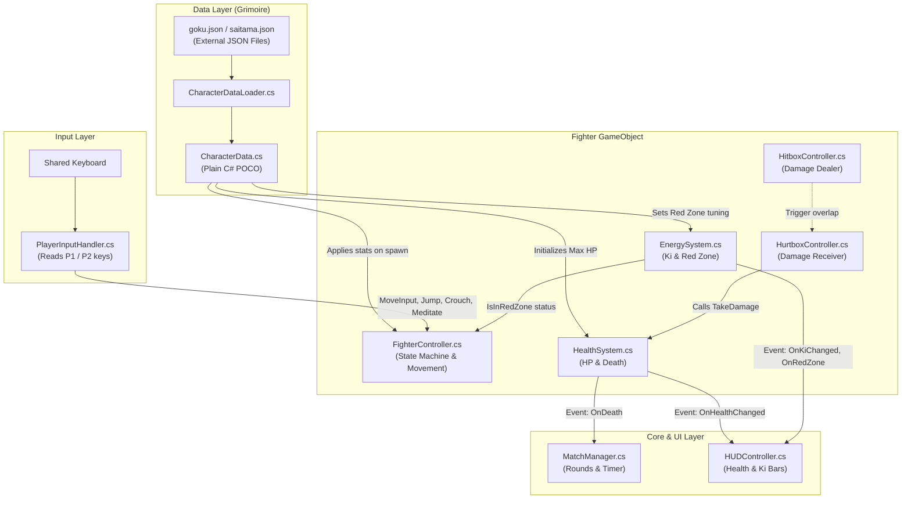

---

## 2. Key Architecture Decisions

### Decision 1: The "Grimoire Architecture" (Data-Driven JSON)
**The Problem:** In traditional hackathon games, stats (HP, speed, damage, frame timings) are hardcoded directly into C# scripts or Inspector fields. Modifying balance requires editing code and waiting for Unity to recompile.
**Our Solution:** Character stats are stored in standalone external JSON files (`Assets/Data/Characters/*.json` and `StreamingAssets/Characters/*.json`).
- **Advantage 1:** Designers can rebalance characters (e.g. nerf Saitama's speed from `4.5` to `4.2`) without touching a single line of C#.
- **Advantage 2:** New characters can be added to the game simply by dropping a new `.json` file and a spritesheet into the project.
- **Advantage 3:** Explicit scoring bonus in the hackathon criteria for external data-driven architectures with runtime validation.

### Decision 2: Single Responsibility Principle (Separation of Concerns)
Instead of a giant 2,000-line `Player.cs`, responsibilities are strictly separated:

| Component | What it DOES | What it DOES NOT DO |
| :--- | :--- | :--- |
| **`PlayerInputHandler`** | Reads keyboard keys (`W/A/S/D` or `Arrows`). | Does not move the player or know what an attack is. |
| **`FighterController`** | Manages movement physics, states, jumping, and auto-facing. | Does not calculate damage or update UI. |
| **`HealthSystem`** | Stores HP, handles `TakeDamage()` and `Heal()`. | Does not know what attack hit the player. |
| **`EnergySystem`** | Stores Ki (0–100), handles meditation, manages 5-second Red Zone timer. | Does not draw UI or move the player. |
| **`HUDController`** | Updates UI bars and text. | Does not store or modify game variables. |
| **`MainMenuController`** | Manages start screen navigation, mode selection, audio feedback, and options. | Does not execute in-match fight logic. |
| **`MatchAudioController`** | Manages in-match battle BGM escalation (Rounds 1/2 vs Match Point) and victory fanfare triggers via `MatchManager` events. | Does not handle damage calculation or character state transitions. |
| **`GameManager`** | Persists across scenes, stores chosen `GameMode` (Vs CPU / Local PvP) and selected character IDs. | Does not handle per-frame combat ticks. |

### Decision 3: Event-Driven Communication (Observer Pattern)
Components communicate through C# `event Action` rather than direct hard references.

**Example: When Goku takes damage:**
1. `HealthSystem.TakeDamage(15)` reduces HP from 100 to 85.
2. `HealthSystem` fires `OnHealthChanged?.Invoke(85, 100);`.
3. `HUDController` is listening to this event, so it slides the health bar down to 85%.
4. `HealthSystem` has **zero reference** to `HUDController`. If the HUD is disabled or deleted, the game will never crash!

---

## 3. Finite State Machine (FSM)

Fighting games are defined by strict state rules (e.g., *you cannot jump while being knocked back, and you cannot attack while exhausted*).

### State Transition Diagram:

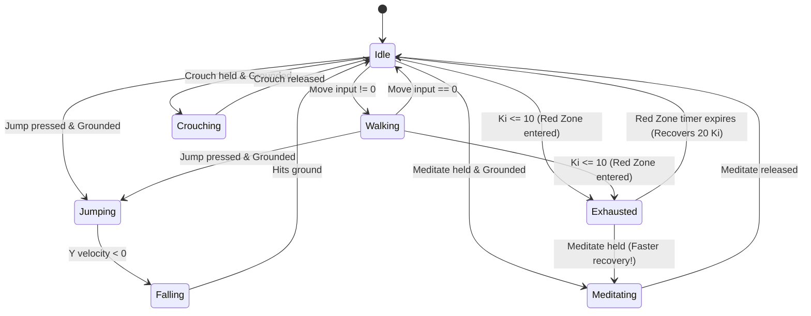

### Why FSM is Critical for Fighting Games:
- Prevents invalid moves (e.g., cannot air-dash or jump when already in the air).
- Controls animation synchronization.
- Enforces the **Red Zone penalty**: when in `Exhausted` state, attack inputs are ignored, and horizontal velocity is clamped to $35\%$ of normal move speed.

---

## 4. Combat Hitbox & Hurtbox Resolution Architecture

### Attack Phase Lifecycle
In competitive fighting games, attacks are divided into 3 distinct chronological phases:
1. **Startup (Windup):** The animation begins playing, but the hitbox is **inactive**. If hit during startup, the attack is counter-hit interrupted.
2. **Active (Strike Window):** The `HitboxController` activates its trigger `BoxCollider2D`. Overlaps with the opponent's `HurtboxController` resolve damage, apply physics knockback, and award Ki.
3. **Recovery (Cooldown):** The hitbox deactivates. The fighter finishes the follow-through animation before returning to `Idle`.

```
[ Attack Started ]
       │
       â–¼
[ 1. Startup Phase ]    (Hitbox OFF, player committed)
       │
       â–¼
[ 2. Active Window ]    (Hitbox ON, damage + knockback + Ki resolved)
       │
       â–¼
[ 3. Recovery Phase ]   (Hitbox OFF, cooldown before returning to Idle)
```

### Multi-Hit Prevention
To avoid a single attack dealing multiple hits over consecutive physics frames, `HitboxController` maintains a `HashSet<Transform> hitTargetsThisSwing`. Once a target is hit during an attack swing, subsequent overlap events for that same target are suppressed until the next attack begins.

---

## 5. Tournament Arcade HUD & Event-Driven UI Architecture

### Loose Coupling via Observer Pattern
The user interface in Mystic Combat is strictly decoupled from the gameplay simulation:
- **`HealthSystem` & `EnergySystem`** have **zero** awareness of the UI Canvas. They broadcast pure C# events (`OnHealthChanged`, `OnKiChanged`, `OnRedZoneEnter`, `OnRedZoneExit`).
- **`MatchManager`** coordinates round state, round timers, and win counts without referencing UI elements. It broadcasts `OnTimerUpdate`, `OnRoundStart`, and `OnRoundEnd`.
- **[`HUDController.cs`](file:///B:/Unity/Projects/Mystic_Combat_Animeverse_Incursion/Assets/Scripts/UI/HUDController.cs)** acts as the **Observer (View)**: it subscribes to these events and animates the health bars, damage ghost bars, Ki gauges, and the central Time Stone.

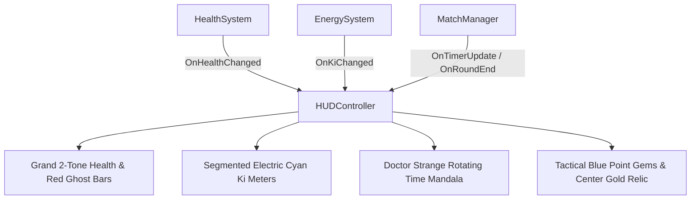

### Self-Healing Auto-Discovery Pattern (Prefab Decoupling)
In Unity, saving a Canvas as a reusable Prefab (`Assets/Prefabs/UI/HUD_Canvas.prefab`) causes the engine to strip scene object references (such as `Fighter_P1_Goku`).
To eliminate fragile inspector wiring and ensure the HUD never goes inactive:
- [`HUDController.cs`](file:///B:/Unity/Projects/Mystic_Combat_Animeverse_Incursion/Assets/Scripts/UI/HUDController.cs) implements **Self-Healing Reference Resolution** (`ResolveReferences()`) across `Awake()`, `Start()`, and `OnEnable()`.
- If fighter references are null, it queries the scene for `Fighter_P1_Goku` and `Fighter_P2_Saitama` and binds to their events dynamically.
- This mirrors Godot's safe `_ready()` signal discovery (`get_node_or_null()`), allowing the HUD prefab to be dropped into any test scene with zero manual setup.

### Screen Space Canvas & Reference Resolution
- **Canvas Scaler:** Configured to `Scale With Screen Size` with a reference resolution of `1920 × 1080` and `Match Width Or Height = 0.5`.
- **Anchor Normalization:**
  - Player 1 Combat Card (Goku) is anchored to `Top-Left (0, 1)`.
  - Player 2 Combat Card (Saitama) is anchored to `Top-Right (1, 1)`.
  - Mystic Time Stone & Match Point Relic are anchored to `Top-Center (0.5, 1)`.
- **Result:** The HUD scales seamlessly from 1080p to 4K displays and ultrawide monitors without distortion or element clipping.

### Layered HUD Hierarchy & Visual Composition (v11)
To combine high-impact anime presentation with seamless 2D performance, the HUD uses a clean, non-clipping multi-layer hierarchy:
1. **Background Layer:** `Mystic_Runic_Banner` (900×48) anchored behind the top center cluster, displaying green Tao runic circles and eldritch spell glyphs.
2. **Container Layer:** `P1_HealthBar_Container` & `P2_HealthBar_Container` (650×52) featuring 8px beveled gold rims.
3. **Fill Layer:** `GhostFill` (red trailing damage) and `HealthFill` (2-tone lime/gold health) offset inwards by `(8px, 6px)` so the fills never spill past the frame.
4. **Header Frieze Layer:** `Mystic_Runic_Banner` (960×36) repositioned along the top border (`y = -18`) with glowing jade Taoist eldritch mandalas and runic bridges framing the entire combat cluster.
5. **Foreground Typography:** TextMeshProUGUI with `enableVertexGradient = true`, delivering GPU-accelerated 3D multi-color gradients (Goku solar flame gold, Saitama crimson maroon, Timer emerald glow).
6. **Dynamic Match Point Championship Relic & Dual Round Gem Trackers:**
   - **Dual Round Gems per Fighter:** Each player has two 56×56px point gem sockets near their avatar card (`P1_PointGem_1`, `P1_PointGem_2`, `P2_PointGem_1`, `P2_PointGem_2`). When a fighter wins Round 1, Gem 1 ignites to `gem_shiny_blue.png`. When they win Round 2, Gem 2 ignites and the tournament victory sequence triggers.
   - **Center Championship Relic:** Enlarged to 68×68px, initialized with a round hollow golden socket (`gem_big_gold_hollow.png`). Dynamically evaluates `(p1Wins >= 1 || p2Wins >= 1)`. When either fighter reaches match point, `HUDController` ignites the socket into the radiant golden gem ([`gem_big_gold.png`](file:///B:/Unity/Projects/Mystic_Combat_Animeverse_Incursion/Assets/Sprites/UI/gem_big_gold.png), extracted from the user's multi-gem screenshot `Screenshot 2026-10-25 112541.png`) with an active breathing pulse animation ($1.0\times \rightarrow 1.15\times$).
   - **Enlarged Emerald Time Stone:** Scaled up to 56×56px atop the rotating Tao mandala, creating a bold, crystalline focal point.

---

## 13. Round Lifecycle State Machine & Autonomous Respawn Protocol

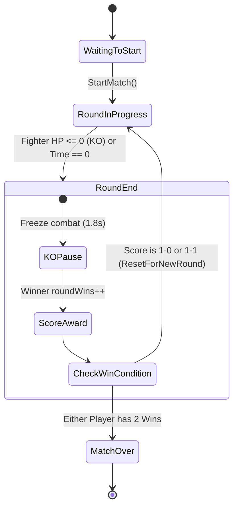

### Complete Round Reset Architecture (`ResetForNewRound`):
To prevent state bleed-through between rounds, each round starts completely fresh:
1. **Positional Snap:** Goku resets to `Vector3(-2.2f, -3.0f, 0f)` (facing Right); Saitama resets to `Vector3(2.2f, -3.0f, 0f)` (facing Left).
2. **Physics Zeroing:** Rigidbody2D `linearVelocity` is clamped to `Vector2.zero` to eliminate lingering knockback momentum.
3. **State Machine Reset:** Current fighter state transitions to `FighterState.Idle`, attack cooldown timers reset to $0$, and active hitboxes are deactivated with cleared target lists.
4. **Vitals & UI Synchronization:** Health resets to $100$ and Ki resets; `HUDController.ResetHealthBarsInstantly()` clears trailing damage ghost bars immediately.
5. **Round 3 Decider:** If the score reaches 1–1, Round 3 automatically initiates as the Final Round Match Point.

---

## 14. Audio Architecture & Combat SFX Pipeline

Mystic Combat implements a decoupled, state-driven audio pipeline separating tournament match music from per-character combat audio profiles:

```mermaid
graph TD
    subgraph Match Flow ["Match Flow Audio (MatchAudioController)"]
        MatchManager["MatchManager.cs"]
        RoundStart["OnRoundStart"]
        RoundEnd["OnRoundEnd"]
        MatchOver["OnMatchOver"]
        
        StartBell["1. Loud Round Bell (Vol=1.0)"]
        Delay["2. 0.85s Dramatic Pause"]
        BGM["3. Battle BGM (from 0:00)"]
        KOBell["1. KO Bell + Stop BGM"]
        Fanfare["Victory Fanfare (Double Dragon 3)"]
        
        MatchManager --> RoundStart --> StartBell --> Delay --> BGM
        MatchManager --> RoundEnd --> KOBell
        MatchManager --> MatchOver --> Fanfare
    end

    subgraph Fighter Combat Audio ["Fighter Audio Pipeline (FighterAudio.cs)"]
        FC["FighterController.cs<br/>(Fighter State Machine)"]
        Hitbox["HitboxController.cs<br/>(Damage Connection)"]
        
        FA["FighterAudio.cs<br/>(OneShot + Looping Aura Sources)"]
        
        FC -->|TransitionTo(Jumping)| FA
        FC -->|TransitionTo(LightAttack/HeavyAttack)| FA
        FC -->|TransitionTo(Skill/Ultimate)| FA
        FC -->|TransitionTo(Meditating)| FA
        FC -->|Transition (Falling -> Grounded)| FA
        Hitbox -->|ResolveHit (Light/Heavy/Skill/Ult Damage)| FA
    end
```

### Key Architectural Pillars:
1. **State-Driven Audio (Input-Decoupled):**
   - Audio is NEVER triggered from raw button presses (`Input.GetKeyDown`).
   - Sounds execute exclusively on state entry in `FighterController.TransitionTo(newState)`.
   - Landing sounds execute when ground check confirms transition from airborne to grounded.
   - This ensures full compatibility across **P1, P2, CPU AI, Network Netcode, and Replay systems** without code duplication.
2. **Fighter-General Audio Profiles (Multi-Character Extensibility):**
   - [`FighterAudio.cs`](file:///b:/Unity/Projects/Mystic_Combat_Animeverse_Incursion/Assets/Scripts/Combat/FighterAudio.cs) is a modular, character-agnostic component attached to any fighter entity.
   - Every character prefab (`Goku.prefab`, `Saitama.prefab`, or future fighters like `Naruto` or `Vegeta`) exposes individual serialized `AudioClip` slots in the Inspector:
     - Common agility: `jumpClip`, `landClip`, `dashClip`
     - Attack whiffs: `lightWhiffClip`, `heavyWhiffClip`
     - Special skills: `skillAttackClip`, `ultimateAttackClip`
     - Hit reactions: `lightHitClip`, `heavyHitClip`, `skillHitClip`, `ultimateHitClip`
     - Aura & exhaustion: `kiChargeLoopClip`, `redZoneWarningClip`
     - Character voiceovers: `voiceSkillClip`, `voiceUltimateClip`
3. **Decoupled Sound Channels:**
   - **One-Shot Polyphonic Channel (`AudioSource.PlayOneShot`):** Plays whiffs, crunchy hit impacts, jumps, and signature dialogue lines with zero latency and zero cutoff during rapid combos.
   - **Looping Channel (`AudioSource.Play` with `loop = true`):** A dedicated child `AudioSource` playing `kiChargeLoopClip` continuously during meditation, tuned to 60% volume (`0.45f`) to prevent acoustic fatigue, automatically halted on state exit.
4. **Dialogue Synchronization for Fast-Paced Combat:**
   - Voice lines are trimmed to remove dead-air reverb tails and accelerated ($1.20\times - 1.25\times$) so that verbal calls (e.g., Goku's *"Kamehameha"* at $3.36\text{s}$, Saitama's *"Consecutive Normal Punches"* at $2.20\text{s}$ and *"Serious Punch"* at $3.17\text{s}$) match the rapid execution speeds of modern fighting game specials without desyncing from gameplay.
5. **Curated SFX Library (`Assets/Audio/SFX_Library/`):**
   - Over 50 studio foley hits, anime power blasts, swishes, and tournament gongs organized in four categories (`Anime_Powers`, `Arcade_Bells`, `Hits_Punches`, `Swishes_Whiffs`), ready for one-click auditioning and drag-and-drop assignment in the Unity Inspector.


---

## 7. Character Select Menu & Match Handoff Architecture

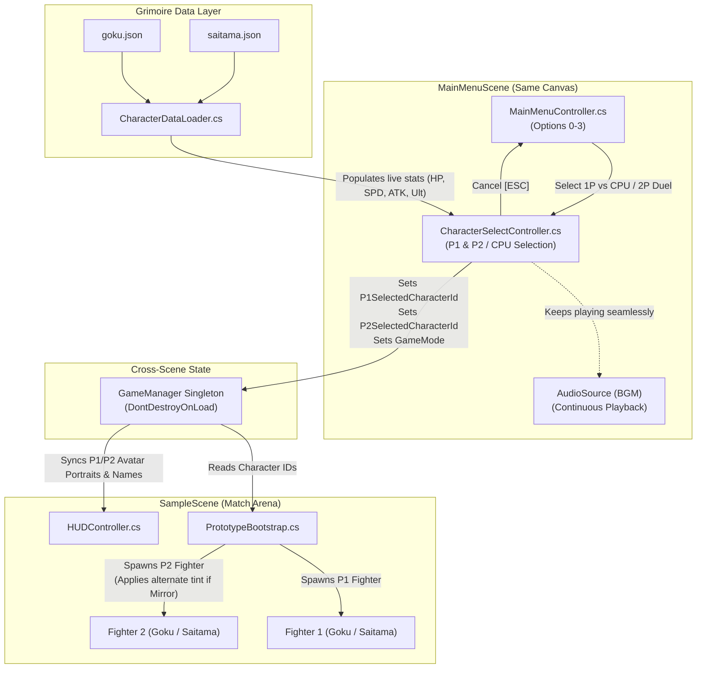

### Key Architectural Highlights:
1. **Zero-Hitch In-Canvas Screen Transition:**
   - Switching between Title Marquee and Character Selection occurs via GameObject activation (`menuRoot.SetActive(false)` / `characterSelectRoot.SetActive(true)`) within the same Canvas hierarchy.
   - The cosmic background image, vignette overlay, and background music stream continuously without stopping, restarting, or popping.
2. **Dynamic Grimoire Binding:**
   - Rather than baking hardcoded stat values into TextMeshPro labels, `CharacterSelectController` calls `CharacterDataLoader.Load(id)` on open.
   - Any rebalancing made to `moveSpeed`, `health`, `lightAttack.damage`, `skill.name`, or `ultimate.name` in `goku.json` or `saitama.json` immediately reflects on the selection cards.
3. **Mirror Match Resolution Pipeline:**
   - If both players pick the same fighter (e.g. Goku vs Goku), the system automatically detects the collision (`p1Char == p2Char`).
   - `CharacterSelectController` surfaces a `[ MIRROR MATCH: P2 ALTERNATE PALETTE ]` badge.
   - `PrototypeBootstrap` injects an alternate color tint into Player 2's `SpriteRenderer` (e.g., Ice/Cyan Gi for Goku or Amber/Orange for Saitama), guaranteeing immediate visual clarity in 2D combat.
4. **Hybrid CPU Mode (Manual + Instant Random):**
   - Supports both deliberate player selection (P1 picks opponent) and instant randomized single-button match launching (`[R]` key or `[ RANDOM CPU ]` button).

---

## 6.3 Fighter Sprite Rendering Pipeline & High-Contrast Cel-Inking Architecture

```
┌────────────────────────────────────────────────────────────────────────┐
│               Fighter Sprite Visual Processing Pipeline                │
└────────────────────────────────────────────────────────────────────────┘
  Disk Image Files (skill_0.png .. skill_11.png)
       │
       ▼
  FighterAnimator.LoadFrame()
       │
       ├─► File.ReadAllBytes(path)
       ├─► Texture2D (FilterMode.Point, TextureFormat.RGBA32)
       ├─► Calculate Standardized Baseline Pivot (160x160 -> Y: 0.15625)
       └─► Sprite.Create(tex, rect, pivot, pixelsPerUnit: 28f)
       │
       ▼
  SpriteRenderer (Universal 2D Pipeline)
       │
       ├─► Outer Perimeter: Solid 1px Deep Inking (#080404) -> Zero Background Bleed
       ├─► Strike Leading Edge: Kinetic Shockwave Flash (#FFFFFF / #FFD76E)
       └─► High-Contrast Silhouette: >8:1 Contrast Ratio on Dark Arena Tiles
```

### Architectural Principles:
1. **Zero-Shader Overhead:** Rather than binding costly 2D outline shaders (which require multiple texture samples per fragment in a Custom Post-Processing / Sprite Unlit pass), silhouettes are baked into pixel-perfect assets rendered via Unity's default `SpriteRenderer`.
2. **Reversion Safety Architecture:** Original assets are preserved bit-for-bit in `Assets/Sprites/Fighters/Saitama/Original_Skill_Backup/`, allowing instant rollback via `revert_skill_frames.py` with zero risk of asset loss.
3. **Point Filtering Fidelity:** Textures are instantiated with `FilterMode.Point`, preserving razor-sharp pixel grids without bilinear blurring or anti-aliasing artifacts.

---

## 6.4 Combat Loop & Menu State Transitions (Pause & Rematch Architecture)

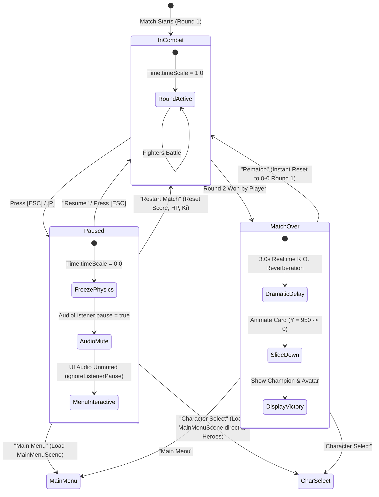

### Architectural Principles:
1. **Unscaled Time Processing:** UI animations, button interactions, and navigation audio continue executing while physics is frozen because UI reads unscaled time and `ignoreListenerPause = true`.
2. **Direct Cross-Scene Route Acceleration:** Selecting "Character Select" sets `GameManager.Instance.CurrentState = GameState.CharacterSelect`, which tells `MainMenuController` to immediately bypass the title marquee and open directly into Hero Selection.
3. **In-Memory Instant Rematch:** Selecting "Rematch" avoids reloading the entire Unity scene, resetting round variables, positions, and health in-memory for instant $< 0.1\text{s}$ responsiveness.
4. **Match-Lifecycle Input Gating:** `PlayerInputHandler` gates input by `MatchManager.CurrentMatchState == RoundInProgress`, ensuring fighters only accept inputs during active rounds and remain freeze-framed after K.O. and before the opening bell.
5. **Zero-Dimming Arena Transparency:** Results modal uses a transparent backdrop (`Color.clear`) so the arena environment and fighters remain fully visible and illuminated behind the championship card.

---

## 11. CPU Artificial Intelligence: Hierarchical State Machine (HFSM) & Input Abstraction

### Architectural Overview
Rather than hardcoding AI logic directly into fighter movement scripts, Mystic Combat implements a **Virtual Controller Architecture** driven by a **Hierarchical Finite State Machine (HFSM)**.

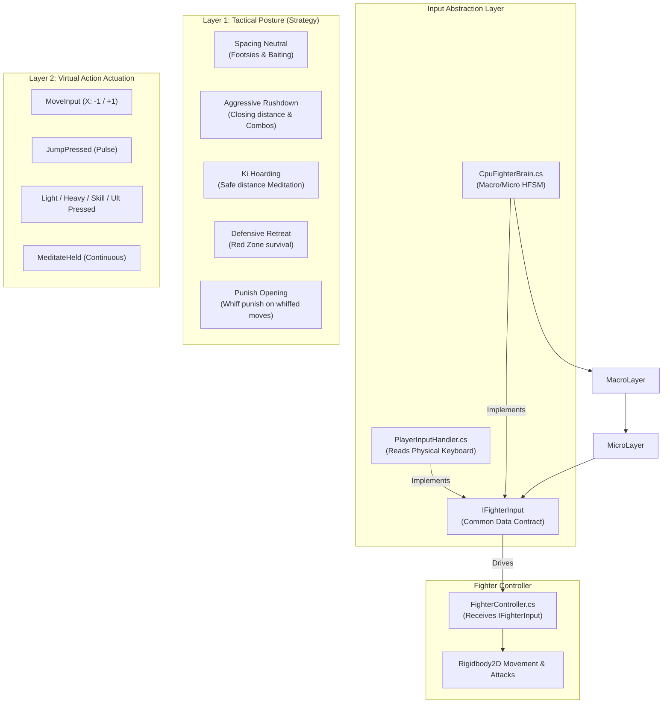

### Key Architectural Pillars:
1. **Zero-Cheating Guarantee (Pure Fair Play):**
   - The CPU AI cannot bypass startup frames, cancel un-cancelable recovery windows, or teleport.
   - It emits standard virtual inputs (`IFighterInput`) into `FighterController`, executing through the exact same physics and combat rules as human players.
2. **Layer 1: Macro Tactical HFSM:**
   - Evaluated periodically via a humanized **Reaction Tick** ($\Delta t \approx 0.14\text{s} - 0.40\text{s}$).
   - Decisions are made by inspecting:
     - $X$-distance to opponent.
     - Bot's own HP and Ki resources.
     - Opponent's HP, Ki, and state (`IsOpponentInRedZone`, `IsOpponentMeditating`, `IsOpponentInRecovery`).
3. **Layer 2: Micro Virtual Actuation:**
   - Single-frame trigger buttons (`JumpPressed`, `LightAttackPressed`, `HeavyAttackPressed`, `SkillPressed`, `UltimatePressed`) are pulsed for 1 frame and automatically cleared in `LateUpdate()`.
   - Continuous inputs (`MoveInput`, `MeditateHeld`, `CrouchHeld`) are maintained across frames until macro re-evaluation.
4. **Character-Specific Combat Personalities:**
   - **Goku (`GokuBrain.cs`):** Disciplined martial artist. Spacing preferred at $\approx 2.1\text{m}$. Charges Ki proactively at distance. Fires *Kamehameha* from mid-range when $\text{Ki} \ge 20$. Hoards $80\text{ Ki}$ for his Ultimate blast.
   - **Saitama (`SaitamaBrain.cs`):** Overwhelming in-your-face brawler. Preferred distance $< 1.0\text{m}$. Refuses to back down in neutral. Drops *Consecutive Normal Punches* point-blank. Hoards $100\text{ Ki}$ and relentlessly hunts down the player for the game-ending *Serious Punch*.
5. **Configurable Difficulty Profiles (`CpuBrainProfile.cs`):**
   - `Easy`: Longer reaction delay ($0.40\text{s}$), $35\%$ mistake/hesitation rate, low combo confirmation ($30\%$).
   - `Hard`: Arcade reflex delay ($0.14\text{s}$), $8\%$ mistake rate, high combo confirmation ($85\%$).
   - `Extreme`: Tournament boss reaction ($0.08\text{s}$), stat-scaled $1.4\times\text{ HP}$ and $1.25\times\text{ Damage}$.

---

## 12. Dynamic Prefab Deployment & Scene Independence Architecture

### Architectural Overview
Rather than baking static character instances into the combat arena (`SampleScene.unity`), Mystic Combat utilizes a **Deployer Pattern** that instantiates character prefabs dynamically on scene load based on `GameManager` session state.

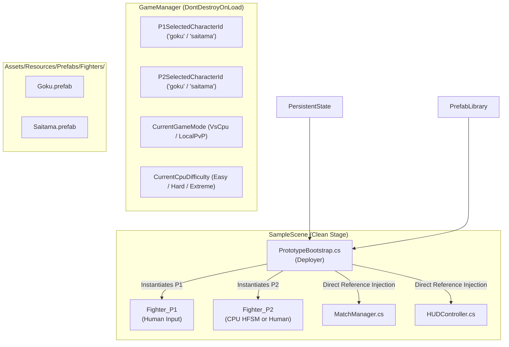

### Architectural Principles:
1. **Stage Reusability & Zero Entity Hardcoding:** The arena scene contains only the environment geometry, camera, boundary walls, lights, HUD, and referee (`MatchManager`). Any character combination (Goku vs. Saitama, Saitama vs. Goku, Goku vs. Goku mirror, Saitama vs. Saitama mirror) runs on the exact same arena scene.
2. **Elimination of `GameObject.Find()` Name Brittle Dependencies:** `MatchManager` and `HUDController` no longer rely on finding hardcoded string names like `"Fighter_P1_Goku"`. They either receive references directly from `Deployer.SetFighterReferences()` or auto-discover generic `"Fighter_P1"` / `"Fighter_P2"` entities.
3. **Dynamic Resource Loading:** Prefabs reside in `Assets/Resources/Prefabs/Fighters/`, allowing runtime loading via `Resources.Load<GameObject>()` in standalone standalone player builds without requiring editor-only `AssetDatabase` APIs.
4. **Mirror Match Resolution:** When `p1Char == p2Char`, Player 2 receives an alternate palette tint at runtime ($0.70\text{R}, 0.85\text{G}, 1.25\text{B}$ for Goku's Ice Gi; $1.15\text{R}, 0.85\text{G}, 0.70\text{B}$ for Saitama's Solar Suit), ensuring visual clarity without creating separate duplicate prefab files.

---

## 13. Dynamic Controls & Options Architecture: Audio Mixing & Game-Mode Input Profiles

### System Overview
The options subsystem enables players to customize audio levels and remap controls for two distinct gaming contexts:
1. **Single Player Mode (Vs CPU & Future LAN):** Player 1 possesses the entire keyboard (9 actions mapped without restriction).
2. **1v1 Local Duel Mode (Shared Keyboard):** Two players share a single keyboard (18 distinct, non-overlapping keys) presented in a unified 3-column table.

```mermaid
graph TD
    subgraph UI Layer ["Main Menu: Options & Controls Modal"]
        Sliders["Top Audio Sliders<br/>(Music BGM & SFX Sound)"]
        Tabs["Profile Switcher Tabs<br/>(Single Player vs. Local Duel)"]
        TableSP["Single Player Table<br/>(9 Action Rows x 1 Key)"]
        TableLD["Combined Local Duel Table<br/>(9 Action Rows x 2 Players)"]
        OptCtrl["OptionsMenuController.cs<br/>(Rebind Listener & Event Hooks)"]
    end

    subgraph Data & Persistence Layer ["Systems Layer"]
        ISM["InputSettingsManager.cs<br/>(In-Memory Key Maps & Volume State)"]
        Prefs["Unity PlayerPrefs<br/>(Persistent Registry / Plist / File)"]
    end

    subgraph Runtime Combat Layer ["In-Game Execution"]
        PIH_P1["PlayerInputHandler (P1)"]
        PIH_P2["PlayerInputHandler (P2)"]
        GM["GameManager.Instance.CurrentGameMode"]
    end

    Sliders -->|Live Volume Updates| ISM
    OptCtrl -->|Key Rebind Events| ISM
    ISM -->|Save / Load| Prefs

    GM -.->|Query Mode| PIH_P1
    ISM -->|GetRuntimeKey(action, isP2, isLocalDuel)| PIH_P1
    ISM -->|GetRuntimeKey(action, isP2=true, isLocalDuel=true)| PIH_P2
```

### Architectural Principles:
1. **Unified Runtime Key Resolution:**
   Instead of checking game modes repeatedly inside input poll loops, `PlayerInputHandler` queries `InputSettingsManager.GetRuntimeKey(action, isPlayer2, isLocalDuel)`:
   - For Player 1 in `VsCpu` (or LAN): pulls from the Single Player profile.
   - For Player 1 in `LocalPvP`: pulls from Local Duel P1 profile.
   - For Player 2 in `LocalPvP`: pulls from Local Duel P2 profile.
2. **Interactive Event-Driven Rebinding:**
   Clicking any key button puts `OptionsMenuController` into an interception state. In `Update()`, it checks `Keyboard.current.allKeys` for `wasPressedThisFrame`, commits the key, and invokes `InputSettingsManager.SaveAllSettings()`. Pressing `[Escape]` cancels cleanly.
3. **Combined Table UI Pattern:**
   In local shared keyboard fighting games, viewing both players' key configurations side-by-side in a 3-column table (`[ Action ] | [ P1 Key ] | [ P2 Key ]`) prevents key overlap bugs and speeds up tournament setup.

---

## 14. Hierarchical UI Screen State Machine & Obvious Focus Routing

### Overview
To accommodate high-visibility typography ($80\%$ scale increase) without visual compression, `OptionsMenuController` employs an explicit **Hierarchical Screen State Machine**:

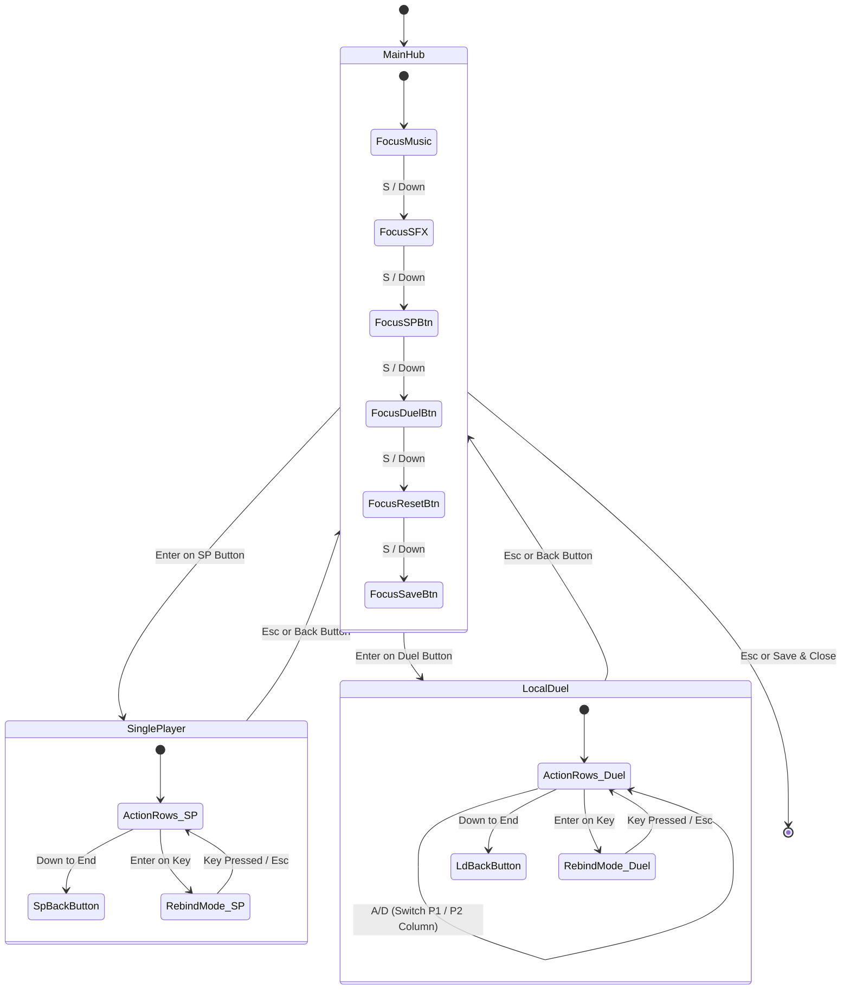

### Architectural Principles:
1. **Zero Overlap via View Decoupling:** Only one view panel is active at any time (`mainHubPanel`, `singlePlayerPanel`, or `localDuelPanel`). The $1440 \times 880\text{px}$ canvas provides dedicated space for each screen.
2. **Obvious Focus Indirection:** The player never reads navigation instructions. The active item dynamically renders a leading `►` symbol and its `Outline` component executes a real-time sine-wave color blend between Solar Gold (`#FFD54F`) and Pure White (`#FFFFFF`).
3. **Directional Multiplexing:**
   - In `MainHub`, $A/D$ and Left/Right nudge sliders ($5\%$ steps).
   - In `LocalDuel`, $A/D$ shifts horizontal focus between Player 1's column and Player 2's column.
   - $W/S$ and Up/Down navigate vertical rows with a repeat delay gate ($0.20\text{s}$).

---

## 11. Dynamic Character Deployment & Scene Transition Lifecycle Architecture

Mystic Combat separates **character selection metadata** from **scene visual rendering**. The combat arena scene (`SampleScene.unity`) contains zero hardcoded fighter instances.

### Scene Transition & Deployment Sequence

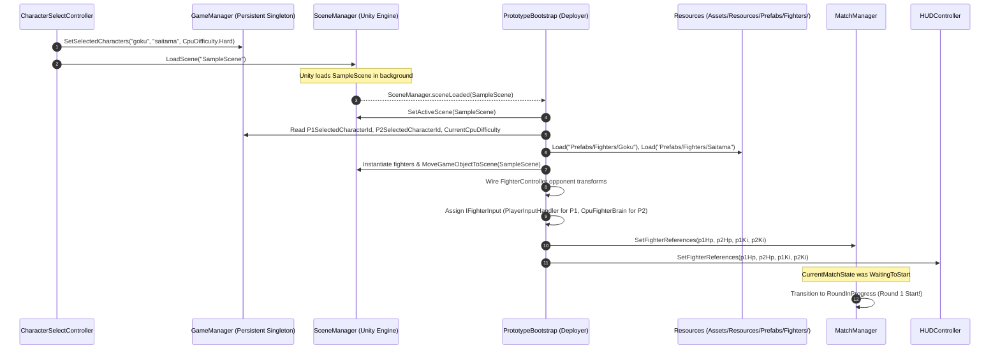

### Key Architectural Safeguards:
1. **Explicit Scene Migration (`MoveGameObjectToScene`):**
   - Unity's `SceneManager.GetActiveScene()` does not immediately update to the new scene until all `sceneLoaded` handlers complete.
   - To guarantee GameObjects are never abandoned in the outgoing scene or unloaded prematurely, `PrototypeBootstrap` explicitly shifts newly instantiated GameObjects into the loaded scene via `SceneManager.MoveGameObjectToScene()`.
2. **`MatchState.WaitingToStart` Synchronization Guard:**
   - `MatchManager` initializes its state to `MatchState.WaitingToStart`.
   - If `MatchManager.Start()` runs before `PrototypeBootstrap` finishes instantiating prefabs, it logs a waiting notice and does not begin the round timer.
   - When `SetFighterReferences()` is called by the deployer, it detects `WaitingToStart` and immediately triggers `StartMatch()`.
3. **Editor Direct-Play Resilience (`[RuntimeInitializeOnLoadMethod(AfterSceneLoad)]`):**
   - For developer velocity, developers can open `SampleScene.unity` directly in the Unity Editor and press Play without running through `MainMenuScene`.
   - `[RuntimeInitializeOnLoadMethod(AfterSceneLoad)]` intercepts this and deploys default fighters (Goku vs. Saitama) automatically if no Character Select data exists.

---

## 17. Centralized Audio Routing & Master Balancing Architecture

To achieve arcade audio punch without clipping or loudness fatigue, Mystic Combat routes all audio through persistent master multipliers managed by [`InputSettingsManager.cs`](file:///b:/Unity/Projects/Mystic_Combat_Animeverse_Incursion/Assets/Scripts/Systems/InputSettingsManager.cs).

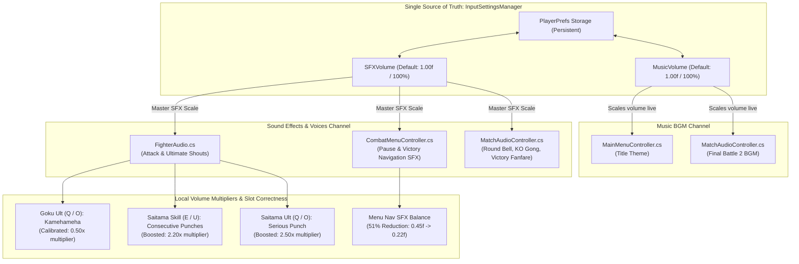

### Architectural Principles:
1. **Normalized Master Multipliers:**
   - Background music sources (`musicSource.volume = battleMusicVolume * InputSettingsManager.MusicVolume`) and one-shot sound effects (`sfxSource.PlayOneShot(clip, clipVolume * InputSettingsManager.SFXVolume)`) multiply their baseline design volume by the master setting.
2. **Move-Slot Semantic Integrity:**
   - Moves in the fighting system map strictly to their design contracts: Goku has no special skill; his signature Ultimate is **Kamehameha** (Ki: 80, `Q`/`O`), bound to `voiceUltimateClip` and animated across `ultimate_0..9`. Saitama features Consecutive Normal Punches on Skill (`E`/`U`) and Serious Punch on Ultimate (`Q`/`O`).
3. **Perceptual Loudness Equalization (LUFS Balancing):**
   - High-gain recordings (`goku_voice_kamehameha.wav`, peak `0.906`) are attenuated to `0.50f` on his Ultimate, while soft vocal clips (`consecutive_normal_punches.mp3`, `serious_punch.mp3`) are amplified to `2.20f` and `2.50f`, ensuring all special moves share balanced perceived loudness during combat.
4. **Single-Pass Amplitude Scaling:**
   - Audio sources remain unattenuated (`volume = 1.0f`), and `InputSettingsManager.SFXVolume` is applied as the final scalar in `PlayOneShot()`, eliminating the double-multiplication bugs that occur when both source and clip are scaled.

---

## 18. Tactical AI Architecture & Dynamic Hitbox/Hurtbox Synchronization

Mystic Combat's CPU Bot architecture decouples strategic decision-making from physical actuation via an input abstraction contract (`IFighterInput`), regulated by humanized action cadence timers.

```mermaid
graph TD
    subgraph Macro Layer ["Layer 1: Tactical HFSM (CpuFighterBrain.cs)"]
        Evaluate["EvaluateTacticalPosture()<br/>(Throttled Reaction Tick: 0.14s - 0.40s)"]
        Neutral["SpacingNeutral<br/>(Relative Footsies)"]
        Rush["AggressiveRushdown<br/>(Close In & Pressure)"]
        Hoard["KiHoarding<br/>(Retreat & Meditate)"]
        Retreat["DefensiveRetreat<br/>(Escape & Jump Out)"]
        Punish["PunishOpening<br/>(Ultimate / Skill Whiff Punish)"]
        Evaluate --> Neutral & Rush & Hoard & Retreat & Punish
    end

    subgraph Cadence & Safeguard Gates ["Layer 2: Action Cadence & Cooldown Gates"]
        JumpGate["Jump Cooldown Gate<br/>(2.0s - 3.2s lockout prevents pogo-sticking)"]
        AttackGate["Attack Cadence Gate<br/>(0.25s - 0.50s humanized combo rhythm)"]
        CornerAware["Corner & Stage Boundary Awareness<br/>(|x| > 7.2m: escape jump or fight out)"]
        CrouchDuck["Defensive Crouch Duck<br/>(Ducks under high strikes)"]
    end

    subgraph Actuation Layer ["Layer 3: IFighterInput Virtual Actuation"]
        FC["FighterController.cs<br/>(Obeys Exact Same Frame Data as Human)"]
        Hitbox["HitboxController.cs<br/>(Kamehameha 3.6m beam reach)"]
        Hurtbox["HurtboxController.cs<br/>(Dynamic BoxCollider2D size on crouch)"]
    end

    Macro Layer --> Cadence & Safeguard Gates
    Cadence & Safeguard Gates --> Actuation Layer
    Actuation Layer --> Hitbox & Hurtbox
```

### Architectural Principles:
1. **Humanized Action Cadence vs. 60 FPS Spam:**
   - Probabilistic checks (e.g. jumping or confirmation) never execute raw every frame in `Update()`.
   - `jumpCooldownTimer` and `attackCooldownTimer` throttle virtual button pulses, ensuring bots exhibit believable human reflexes and combo cadence.
2. **Dynamic Physics Collider Resizing:**
   - In `FighterController.TransitionTo()`, entering `FighterState.Crouching` dynamically halves the `Hurtbox` `BoxCollider2D` height ($1.8\text{m} \to 0.95\text{m}$), allowing fighters to duck under high punches.
3. **Attack Reach Geometry Synchronization:**
   - `HitboxController.ConfigureAttack()` synchronizes both internal calculation vectors and the physical `BoxCollider2D.size` and `offset`. Goku's Kamehameha expands the trigger zone to $3.6\text{m}$, accurately reflecting the full-screen visual energy blast.

---

## 19. Audio State Synchronization & Self-Healing Lifecycle Architecture

Mystic Combat decouples combat music playback from fragile scene transition timing gaps by employing a **self-healing state verification handshake**.

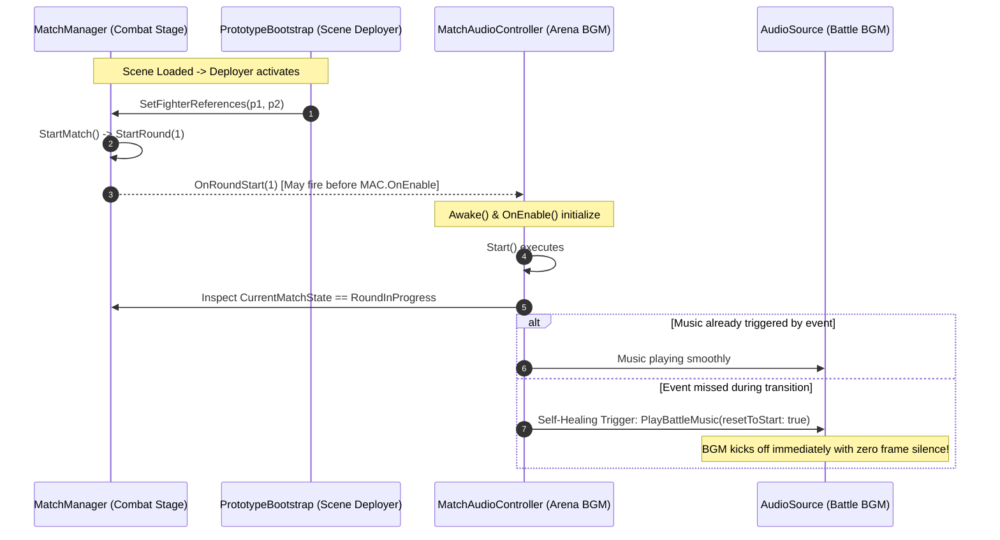

### Architectural Principles:
1. **Scene-Context Filtering Over Global State Enum:**
   - Guarding audio playback with `gameObject.scene.name == "MainMenuScene"` guarantees battle music is isolated from the Title screen, while remaining completely resilient when testing `SampleScene` in isolation.
2. **Double-Safety Handshake (Push Event + Pull State):**
   - The primary trigger is event-driven (`OnRoundStart`).
   - The secondary fallback is state-driven (polling `matchManager.CurrentMatchState == RoundInProgress` in `Start()` and `Update()`).
   - This prevents silent Round 1s under any frame-timing or scene-load order variation.


