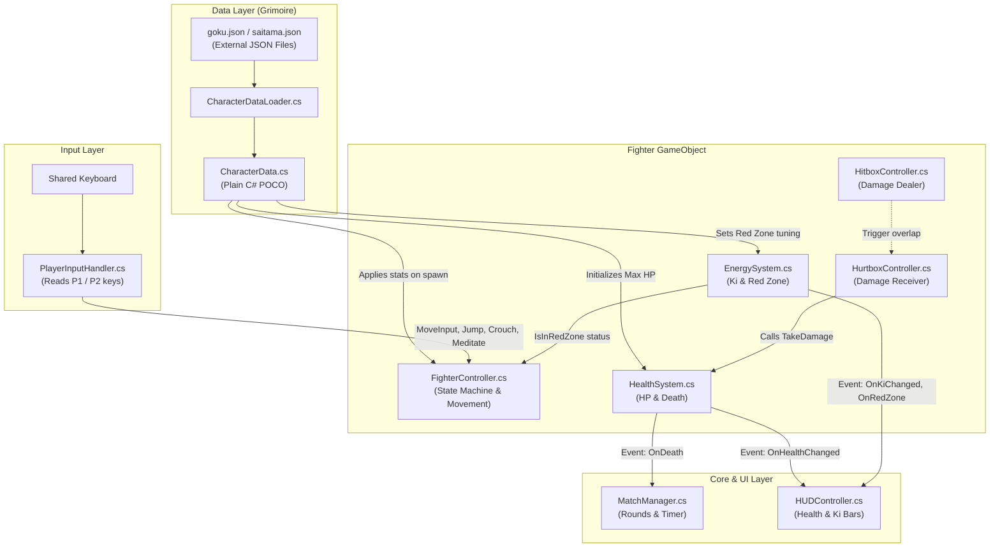
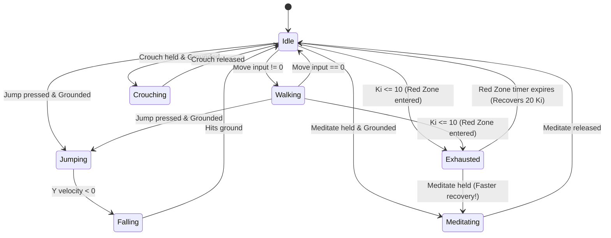
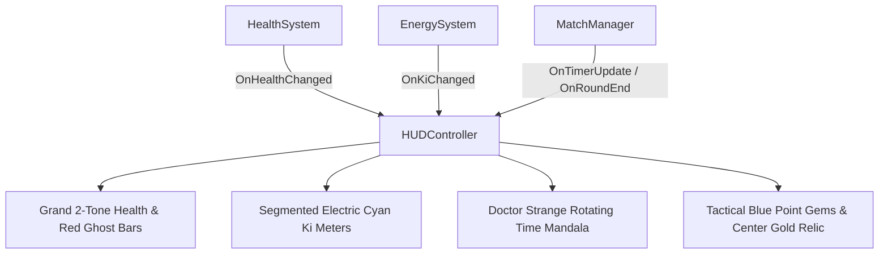
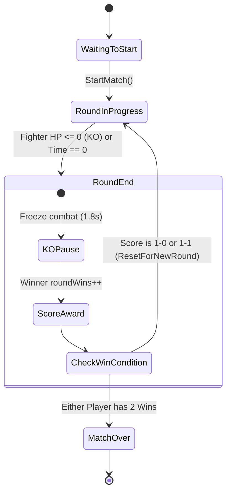

# 02. System Architecture & Design Patterns

> **Audience:** Core team developers, code reviewers, and viva / project defense evaluators.

---

## 1. High-Level Architectural Diagram

Mystic Combat is designed around **decoupled, modular components** communicating via **Data Contracts** and **C# Events**. No monolithic "Player" script exists.



---

## 2. Key Architecture Decisions

### Decision 1: The "Grimoire Architecture" (Data-Driven JSON)
**The Problem:** In traditional hackathon games, stats (HP, speed, damage, frame timings) are hardcoded directly into C# scripts or Inspector fields. Modifying balance requires editing code and waiting for Unity to recompile.
**Our Solution:** Character stats are stored in standalone external JSON files (`Assets/Data/Characters/*.json` and `StreamingAssets/Characters/*.json`).
- **Advantage 1:** Designers can rebalance characters (e.g. nerf Saitama's speed from `4.5` to `4.2`) without touching a single line of C#.
- **Advantage 2:** New characters can be added to the game simply by dropping a new `.json` file and a spritesheet into the project.
- **Advantage 3:** Explicit scoring bonus in the hackathon criteria for external data-driven architectures with runtime validation.

### Decision 2: Single Responsibility Principle (Separation of Concerns)
Instead of a giant 2,000-line `Player.cs`, responsibilities are strictly separated:

| Component | What it DOES | What it DOES NOT DO |
| :--- | :--- | :--- |
| **`PlayerInputHandler`** | Reads keyboard keys (`W/A/S/D` or `Arrows`). | Does not move the player or know what an attack is. |
| **`FighterController`** | Manages movement physics, states, jumping, and auto-facing. | Does not calculate damage or update UI. |
| **`HealthSystem`** | Stores HP, handles `TakeDamage()` and `Heal()`. | Does not know what attack hit the player. |
| **`EnergySystem`** | Stores Ki (0–100), handles meditation, manages 5-second Red Zone timer. | Does not draw UI or move the player. |
| **`HUDController`** | Updates UI bars and text. | Does not store or modify game variables. |
| **`MainMenuController`** | Manages start screen navigation, mode selection, audio feedback, and options. | Does not execute in-match fight logic. |
| **`MatchAudioController`** | Manages in-match battle BGM escalation (Rounds 1/2 vs Match Point) and victory fanfare triggers via `MatchManager` events. | Does not handle damage calculation or character state transitions. |
| **`GameManager`** | Persists across scenes, stores chosen `GameMode` (Vs CPU / Local PvP) and selected character IDs. | Does not handle per-frame combat ticks. |

### Decision 3: Event-Driven Communication (Observer Pattern)
Components communicate through C# `event Action` rather than direct hard references.

**Example: When Goku takes damage:**
1. `HealthSystem.TakeDamage(15)` reduces HP from 100 to 85.
2. `HealthSystem` fires `OnHealthChanged?.Invoke(85, 100);`.
3. `HUDController` is listening to this event, so it slides the health bar down to 85%.
4. `HealthSystem` has **zero reference** to `HUDController`. If the HUD is disabled or deleted, the game will never crash!

---

## 3. Finite State Machine (FSM)

Fighting games are defined by strict state rules (e.g., *you cannot jump while being knocked back, and you cannot attack while exhausted*).

### State Transition Diagram:



### Why FSM is Critical for Fighting Games:
- Prevents invalid moves (e.g., cannot air-dash or jump when already in the air).
- Controls animation synchronization.
- Enforces the **Red Zone penalty**: when in `Exhausted` state, attack inputs are ignored, and horizontal velocity is clamped to $35\%$ of normal move speed.

---

## 4. Combat Hitbox & Hurtbox Resolution Architecture

### Attack Phase Lifecycle
In competitive fighting games, attacks are divided into 3 distinct chronological phases:
1. **Startup (Windup):** The animation begins playing, but the hitbox is **inactive**. If hit during startup, the attack is counter-hit interrupted.
2. **Active (Strike Window):** The `HitboxController` activates its trigger `BoxCollider2D`. Overlaps with the opponent's `HurtboxController` resolve damage, apply physics knockback, and award Ki.
3. **Recovery (Cooldown):** The hitbox deactivates. The fighter finishes the follow-through animation before returning to `Idle`.

```
[ Attack Started ]
       │
       ▼
[ 1. Startup Phase ]    (Hitbox OFF, player committed)
       │
       ▼
[ 2. Active Window ]    (Hitbox ON, damage + knockback + Ki resolved)
       │
       ▼
[ 3. Recovery Phase ]   (Hitbox OFF, cooldown before returning to Idle)
```

### Multi-Hit Prevention
To avoid a single attack dealing multiple hits over consecutive physics frames, `HitboxController` maintains a `HashSet<Transform> hitTargetsThisSwing`. Once a target is hit during an attack swing, subsequent overlap events for that same target are suppressed until the next attack begins.

---

## 5. Tournament Arcade HUD & Event-Driven UI Architecture

### Loose Coupling via Observer Pattern
The user interface in Mystic Combat is strictly decoupled from the gameplay simulation:
- **`HealthSystem` & `EnergySystem`** have **zero** awareness of the UI Canvas. They broadcast pure C# events (`OnHealthChanged`, `OnKiChanged`, `OnRedZoneEnter`, `OnRedZoneExit`).
- **`MatchManager`** coordinates round state, round timers, and win counts without referencing UI elements. It broadcasts `OnTimerUpdate`, `OnRoundStart`, and `OnRoundEnd`.
- **[`HUDController.cs`](file:///B:/Unity/Projects/Mystic_Combat_Animeverse_Incursion/Assets/Scripts/UI/HUDController.cs)** acts as the **Observer (View)**: it subscribes to these events and animates the health bars, damage ghost bars, Ki gauges, and the central Time Stone.



### Self-Healing Auto-Discovery Pattern (Prefab Decoupling)
In Unity, saving a Canvas as a reusable Prefab (`Assets/Prefabs/UI/HUD_Canvas.prefab`) causes the engine to strip scene object references (such as `Fighter_P1_Goku`).
To eliminate fragile inspector wiring and ensure the HUD never goes inactive:
- [`HUDController.cs`](file:///B:/Unity/Projects/Mystic_Combat_Animeverse_Incursion/Assets/Scripts/UI/HUDController.cs) implements **Self-Healing Reference Resolution** (`ResolveReferences()`) across `Awake()`, `Start()`, and `OnEnable()`.
- If fighter references are null, it queries the scene for `Fighter_P1_Goku` and `Fighter_P2_Saitama` and binds to their events dynamically.
- This mirrors Godot's safe `_ready()` signal discovery (`get_node_or_null()`), allowing the HUD prefab to be dropped into any test scene with zero manual setup.

### Screen Space Canvas & Reference Resolution
- **Canvas Scaler:** Configured to `Scale With Screen Size` with a reference resolution of `1920 × 1080` and `Match Width Or Height = 0.5`.
- **Anchor Normalization:**
  - Player 1 Combat Card (Goku) is anchored to `Top-Left (0, 1)`.
  - Player 2 Combat Card (Saitama) is anchored to `Top-Right (1, 1)`.
  - Mystic Time Stone & Match Point Relic are anchored to `Top-Center (0.5, 1)`.
- **Result:** The HUD scales seamlessly from 1080p to 4K displays and ultrawide monitors without distortion or element clipping.

### Layered HUD Hierarchy & Visual Composition (v11)
To combine high-impact anime presentation with seamless 2D performance, the HUD uses a clean, non-clipping multi-layer hierarchy:
1. **Background Layer:** `Mystic_Runic_Banner` (900×48) anchored behind the top center cluster, displaying green Tao runic circles and eldritch spell glyphs.
2. **Container Layer:** `P1_HealthBar_Container` & `P2_HealthBar_Container` (650×52) featuring 8px beveled gold rims.
3. **Fill Layer:** `GhostFill` (red trailing damage) and `HealthFill` (2-tone lime/gold health) offset inwards by `(8px, 6px)` so the fills never spill past the frame.
4. **Header Frieze Layer:** `Mystic_Runic_Banner` (960×36) repositioned along the top border (`y = -18`) with glowing jade Taoist eldritch mandalas and runic bridges framing the entire combat cluster.
5. **Foreground Typography:** TextMeshProUGUI with `enableVertexGradient = true`, delivering GPU-accelerated 3D multi-color gradients (Goku solar flame gold, Saitama crimson maroon, Timer emerald glow).
6. **Dynamic Match Point Championship Relic & Dual Round Gem Trackers:**
   - **Dual Round Gems per Fighter:** Each player has two 56×56px point gem sockets near their avatar card (`P1_PointGem_1`, `P1_PointGem_2`, `P2_PointGem_1`, `P2_PointGem_2`). When a fighter wins Round 1, Gem 1 ignites to `gem_shiny_blue.png`. When they win Round 2, Gem 2 ignites and the tournament victory sequence triggers.
   - **Center Championship Relic:** Enlarged to 68×68px, initialized with a round hollow golden socket (`gem_big_gold_hollow.png`). Dynamically evaluates `(p1Wins >= 1 || p2Wins >= 1)`. When either fighter reaches match point, `HUDController` ignites the socket into the radiant golden gem ([`gem_big_gold.png`](file:///B:/Unity/Projects/Mystic_Combat_Animeverse_Incursion/Assets/Sprites/UI/gem_big_gold.png), extracted from the user's multi-gem screenshot `Screenshot 2026-10-25 112541.png`) with an active breathing pulse animation ($1.0\times \rightarrow 1.15\times$).
   - **Enlarged Emerald Time Stone:** Scaled up to 56×56px atop the rotating Tao mandala, creating a bold, crystalline focal point.

---

## 13. Round Lifecycle State Machine & Autonomous Respawn Protocol



### Complete Round Reset Architecture (`ResetForNewRound`):
To prevent state bleed-through between rounds, each round starts completely fresh:
1. **Positional Snap:** Goku resets to `Vector3(-2.2f, -3.0f, 0f)` (facing Right); Saitama resets to `Vector3(2.2f, -3.0f, 0f)` (facing Left).
2. **Physics Zeroing:** Rigidbody2D `linearVelocity` is clamped to `Vector2.zero` to eliminate lingering knockback momentum.
3. **State Machine Reset:** Current fighter state transitions to `FighterState.Idle`, attack cooldown timers reset to $0$, and active hitboxes are deactivated with cleared target lists.
4. **Vitals & UI Synchronization:** Health resets to $100$ and Ki resets; `HUDController.ResetHealthBarsInstantly()` clears trailing damage ghost bars immediately.
5. **Round 3 Decider:** If the score reaches 1–1, Round 3 automatically initiates as the Final Round Match Point.

---

## 14. Audio Architecture & Combat SFX Pipeline

Mystic Combat implements a decoupled, state-driven audio pipeline separating tournament match music from per-character combat audio profiles:

```mermaid
graph TD
    subgraph Match Flow ["Match Flow Audio (MatchAudioController)"]
        MatchManager["MatchManager.cs"]
        RoundStart["OnRoundStart"]
        RoundEnd["OnRoundEnd"]
        MatchOver["OnMatchOver"]
        
        StartBell["1. Loud Round Bell (Vol=1.0)"]
        Delay["2. 0.85s Dramatic Pause"]
        BGM["3. Battle BGM (from 0:00)"]
        KOBell["1. KO Bell + Stop BGM"]
        Fanfare["Victory Fanfare (Double Dragon 3)"]
        
        MatchManager --> RoundStart --> StartBell --> Delay --> BGM
        MatchManager --> RoundEnd --> KOBell
        MatchManager --> MatchOver --> Fanfare
    end

    subgraph Fighter Combat Audio ["Fighter Audio Pipeline (FighterAudio.cs)"]
        FC["FighterController.cs<br/>(Fighter State Machine)"]
        Hitbox["HitboxController.cs<br/>(Damage Connection)"]
        
        FA["FighterAudio.cs<br/>(OneShot + Looping Aura Sources)"]
        
        FC -->|TransitionTo(Jumping)| FA
        FC -->|TransitionTo(LightAttack/HeavyAttack)| FA
        FC -->|TransitionTo(Skill/Ultimate)| FA
        FC -->|TransitionTo(Meditating)| FA
        FC -->|Transition (Falling -> Grounded)| FA
        Hitbox -->|ResolveHit (Light/Heavy/Skill/Ult Damage)| FA
    end
```

### Key Architectural Pillars:
1. **State-Driven Audio (Input-Decoupled):**
   - Audio is NEVER triggered from raw button presses (`Input.GetKeyDown`).
   - Sounds execute exclusively on state entry in `FighterController.TransitionTo(newState)`.
   - Landing sounds execute when ground check confirms transition from airborne to grounded.
   - This ensures full compatibility across **P1, P2, CPU AI, Network Netcode, and Replay systems** without code duplication.
2. **Fighter-General Audio Profiles (Multi-Character Extensibility):**
   - [`FighterAudio.cs`](file:///b:/Unity/Projects/Mystic_Combat_Animeverse_Incursion/Assets/Scripts/Combat/FighterAudio.cs) is a modular, character-agnostic component attached to any fighter entity.
   - Every character prefab (`Goku.prefab`, `Saitama.prefab`, or future fighters like `Naruto` or `Vegeta`) exposes individual serialized `AudioClip` slots in the Inspector:
     - Common agility: `jumpClip`, `landClip`, `dashClip`
     - Attack whiffs: `lightWhiffClip`, `heavyWhiffClip`
     - Special skills: `skillAttackClip`, `ultimateAttackClip`
     - Hit reactions: `lightHitClip`, `heavyHitClip`, `skillHitClip`, `ultimateHitClip`
     - Aura & exhaustion: `kiChargeLoopClip`, `redZoneWarningClip`
     - Character voiceovers: `voiceSkillClip`, `voiceUltimateClip`
3. **Decoupled Sound Channels:**
   - **One-Shot Polyphonic Channel (`AudioSource.PlayOneShot`):** Plays whiffs, crunchy hit impacts, jumps, and signature dialogue lines with zero latency and zero cutoff during rapid combos.
   - **Looping Channel (`AudioSource.Play` with `loop = true`):** A dedicated child `AudioSource` playing `kiChargeLoopClip` continuously during meditation, tuned to 60% volume (`0.45f`) to prevent acoustic fatigue, automatically halted on state exit.
4. **Dialogue Synchronization for Fast-Paced Combat:**
   - Voice lines are trimmed to remove dead-air reverb tails and accelerated ($1.20\times - 1.25\times$) so that verbal calls (e.g., Goku's *"Kamehameha"* at $3.36\text{s}$, Saitama's *"Consecutive Normal Punches"* at $2.20\text{s}$ and *"Serious Punch"* at $3.17\text{s}$) match the rapid execution speeds of modern fighting game specials without desyncing from gameplay.
5. **Curated SFX Library (`Assets/Audio/SFX_Library/`):**
   - Over 50 studio foley hits, anime power blasts, swishes, and tournament gongs organized in four categories (`Anime_Powers`, `Arcade_Bells`, `Hits_Punches`, `Swishes_Whiffs`), ready for one-click auditioning and drag-and-drop assignment in the Unity Inspector.


