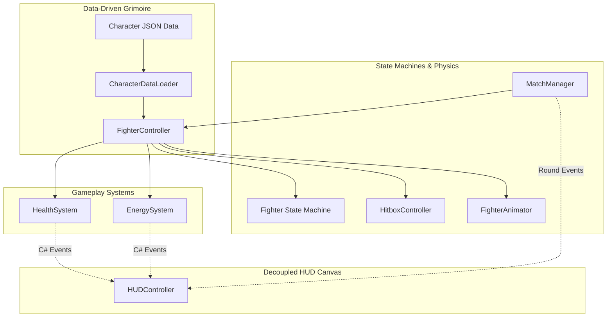

# 🥋 Mystic Combat: Animeverse Incursion

<div align="center">


<br/>

**A fast-paced, 16-bit arcade fighting game built from the ground up in Unity 6.**  
*Featuring authentic pixel art, Doctor Strange mystic relics, data-driven balance, sub-pixel hitboxes, and tournament-grade best-of-3 round flow.*

[🎮 Key Features](#-key-features) • [🕹️ Controls](#️-controls) • [👥 Character Roster](#-character-roster) • [📐 System Architecture](#-system-architecture-for-judges) • [🚀 How to Play](#-how-to-play) • [📚 Team Documentation](#-internal-team-documentation)

---

</div>

## 🌌 Synopsis & Lore

When Doctor Strange attempts a forbidden temporal incantation to seal an eldritch dimensional rift, the spell destabilizes the multiverse. Spacetime fractures across dimensions, violently pulling two of the strongest beings in the Animeverse into the **Mystic Tournament Arena**:

* **Son Goku** (Dragon Ball) — The Saiyan raised on Earth, master of godlike Ki, relentless martial artist.
* **Saitama** (One-Punch Man) — The hero who broke his physical limiter, possessing immeasurable kinetic devastation.

Bounded by ancient Taoist runic barriers and governed by the **Emerald Time Stone**, only one warrior can claim championship victory and return to their universe!

---

## 🎮 Key Features

### 🥊 1. Authentic 16-Bit Arcade Combat
* **Multi-Frame Pixel Art Animations:** Fluid breathing Idle loops, crisp Walk cycles, physics-driven Jump/Fall transitions, Crouch guards, Light Punches, Heavy Attacks, Special Skills, and Cinematic Ultimates.
* **Responsive State Machine:** Zero input lag, tight cancellation windows, and distinct Startup, Active, and Recovery frame data for tournament-grade reads.
* **Sub-Pixel Hitbox Engine:** Dedicated 2D trigger colliders on a strict physics layer matrix with automatic hit-target caches to prevent duplicate hits during active swings.

### 🔮 2. Dynamic Doctor Strange Tournament HUD
* **Active Tao Spell Mandala:** A 160×160 concentric runic green mandala continuously spinning at $22^\circ/\text{s}$ behind the clock.
* **The Emerald Time Stone:** User-provided authentic artifact cleaned of white compression halos, preserved with diamond specular facets, and mounted directly atop the countdown dial.
* **3D Vertex Gradient Typography:** GPU-accelerated 4-corner gradients (Goku solar flame gold, Saitama crimson-maroon, electric emerald countdown numerals).
* **Smooth Ghost Damage Bars:** Heavy 650×52px health bars with 2-tone arcade fills and trailing warning-red ghost bars that drain smoothly after hitstun.
* **Tactical Dual-Gem Win Indicators:** Two discrete 56×56px gem sockets per fighter. Empty at 0 wins, igniting into radiant sapphire crystals on scored rounds.
* **Championship Match Point Relic:** The central 68×68px golden relic starts as an empty hollow socket during neutral rounds, but dynamically ignites into the **authentic golden crystal** with an active breathing sine-wave pulse ($1.0\times \rightarrow 1.15\times$) as soon as either player reaches Match Point!

### 🔄 3. Autonomous Round Lifecycle & Round 3 Decider
* **1.8s K.O. Freeze:** Combat smoothly pauses on the final hit so players feel the impact of the knockout.
* **Clean Arena Respawn:** Fighters automatically reset to neutral starting coordinates (`-2.2` and `+2.2`), velocities zeroed out, attack hitboxes deactivated, and health/ghost bars refilled to 100%.
* **Automatic Best-of-3 Flow:**
  $$\text{Round 1} \longrightarrow \text{Round 2} \longrightarrow \begin{cases} \text{Round 3 (Final Round Match Point)} & \text{if tied 1--1} \\ \text{Tournament Victory} & \text{if 2--0 sweep} \end{cases}$$

### 📜 4. Data-Driven "Grimoire" JSON Engine
* Character balance is 100% decoupled from code into `goku.json` and `saitama.json`.
* Tweak move speed, jump velocity, gravity scale, Ki meditation channel rates, and attack damage in plain JSON without re-compiling C# scripts.

---

## 🕹️ Controls

Two players can battle simultaneously on a single keyboard:

| Action | Player 1 (Goku - Left) | Player 2 (Saitama - Right) |
| :--- | :---: | :---: |
| **Move Left / Right** | <kbd>A</kbd> / <kbd>D</kbd> | <kbd>←</kbd> / <kbd>→</kbd> |
| **Jump** | <kbd>W</kbd> | <kbd>↑</kbd> |
| **Crouch** | <kbd>S</kbd> | <kbd>↓</kbd> |
| **Light Attack (Punch)** | <kbd>F</kbd> | <kbd>K</kbd> |
| **Heavy Strike** | <kbd>H</kbd> | <kbd>L</kbd> |
| **Special Skill** | <kbd>R</kbd> *(Costs 25 Ki)* | <kbd>P</kbd> *(Costs 25 Ki)* |
| **Ultimate Attack** | <kbd>T</kbd> *(Costs 100 Ki)* | <kbd>O</kbd> *(Costs 100 Ki)* |
| **Meditate (Channel Ki)** | <kbd>G</kbd> *(Hold)* | <kbd>M</kbd> *(Hold)* |

> **Auto-Facing System:** Fighters automatically face each other at all times. If you jump over your opponent, your fighter immediately flips horizontally to face the target.

---

## 👥 Character Roster

```
                  ===================================================
                               SON GOKU vs. SAITAMA
                  ===================================================
```

### 🥋 Son Goku (The Saiyan Champion)
* **Archetype:** Balanced Rushdown & Energy Sorcerer.
* **Base Stats:** Speed `6.5`, Jump `12.5`, Ki Meditation Rate `20.0 Ki/s`.
* **Light Attack:** Quick jab combo ($10\text{ DMG}$).
* **Heavy Attack:** Lunging dragon palm strike ($22\text{ DMG}$).
* **Special Skill:** *Super Saiyan Ki Flurry* — High-speed energy punches that pin the opponent in hitstun ($35\text{ DMG}$).
* **Ultimate:** *Spirit Bomb* — Gathers ambient energy and unleashes a cataclysmic shockwave ($75\text{ DMG}$).

### 👊 Saitama (The Caped Baldy)
* **Archetype:** Heavy Kinetic Juggernaut.
* **Base Stats:** Speed `6.0`, Jump `12.0`, Ki Meditation Rate `15.0 Ki/s`.
* **Light Attack:** Casual left hook ($12\text{ DMG}$).
* **Heavy Attack:** Heavy straight punch with massive knockback impulse ($25\text{ DMG}$).
* **Special Skill:** *Consecutive Normal Punches* — A blistering barrage of kinetic shockwaves ($40\text{ DMG}$).
* **Ultimate:** *Serious Punch* — The atmosphere-cleaving strike that ends all resistance ($80\text{ DMG}$).

---

## 📐 System Architecture (For Judges)

The game is engineered with clean, modular, production-ready software patterns:



### Engineering Highlights:
1. **Decoupled Event Architecture:** The UI never polls fighter components in `Update()`. When a fighter takes damage, `HealthSystem.OnHealthChanged` fires a C# event (`Action<int, int>`), allowing the HUD to react instantly with zero frame overhead.
2. **Dynamic Runtime Instance Resolution (`IsInActiveScene`):** Solved Unity's prefab asset-pointer pitfall where nested canvases re-wire to disk assets instead of live scene instances.
3. **Multi-Platform Godot-Style WYSIWYG Workflow:** Created `SceneSetupTool.cs`, which bakes background, collliders, fighters, and the glowing HUD into true Unity Prefab Instances so developers can double-click and visually edit any element in isolation.
4. **Point-Filtered Pixel Art Pipeline:** Custom asset processing ensures that high-resolution retro rips retain knife-edge silhouette sharpness without bilinear blur or compression artifacts.

---

## 🚀 How to Play

### Prerequisites:
* **Unity Version:** Unity 6 (`6000.6.7f1` or later).
* **Render Pipeline:** Universal Render Pipeline (URP).
* **OS:** Windows 10/11.

### Quick Setup:
1. Open the project folder in **Unity Hub**.
2. Open `Assets/Scenes/SampleScene.unity`.
3. In Unity's top menu bar, click:
   $$\mathbf{Mystic\ Combat} \longrightarrow \mathbf{Bake\ Complete\ Project\ (All\ Scenes\ \&\ Prefabs)}$$
4. Press the **Play button** ($\blacktriangleright$) at the top of the Unity Editor!

---

## 📚 Internal Team Documentation

For team members, educators, or examiners seeking an exhaustive line-by-line technical deep dive, the repository contains a comprehensive **5-part master knowledge base** in the [`Docs/`](Docs/) directory:

| Document | Description |
| :--- | :--- |
| [**01. Unity for Beginners**](Docs/01_UNITY_FOR_BEGINNERS.md) | Game development fundamentals, Unity lifecycle, 2D physics, and direct Godot-to-Unity architectural analogies. |
| [**02. System Architecture**](Docs/02_ARCHITECTURE.md) | Component graph, State Machine design, event-driven HUD binding, and round lifecycle state diagrams. |
| [**03. Feature Breakdown**](Docs/03_FEATURE_BREAKDOWN.md) | Complete documentation of all features, hitbox math, Doctor Strange visual relics, and combat mechanics. |
| [**04. Viva & Interview Prep**](Docs/04_VIVA_AND_INTERVIEW_PREP.md) | **27 Hackathon Jury & Viva Defense Q&As** covering system design trade-offs, architecture choices, and a step-by-step judge demonstration guide. |
| [**05. Dev Log & Bug Postmortems**](Docs/05_DEV_LOG_AND_BUGS.md) | Comprehensive engineering postmortems detailing bugs solved (synchronous round reset bug, prefab disk pointer pitfalls, Unity 6 TMP deprecations). |

---

<div align="center">

**Built with passion for competitive fighting games and anime lore.**  
*Crafted for the Hackathon Evaluation & Tournament Showdown.*

</div>
